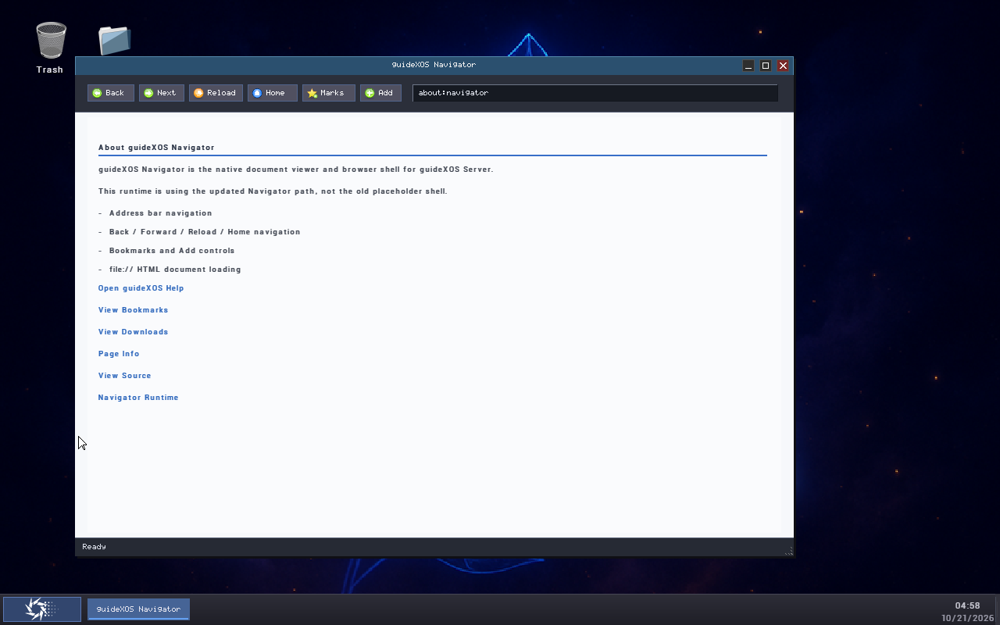

# guideXOS Server v0.3 — S22R10 PacMan Guest Qualification

**Outcome C — `GUEST_RELEASE_BLOCKER`.** The verified candidate boots, and the desktop plus built-in Settings and Navigator operate in the guest. On two independent cold boots with writable storage copied from the candidate’s own ESP, PacMan is discovered during startup, then `/Apps` becomes unavailable to Native ELF rediscovery before the Start menu is built. PacMan disappears from the menu and cannot be launched. PacMan gameplay acceptance therefore failed; the candidate is blocked from release qualification pending runtime integration triage.

This report records guest observations. It does not authorize publication or RC readiness.

## 1. Repository and candidate provenance

- Repository: `D:\dev\guideXOSServer`
- Branch at preflight: `main`
- Starting HEAD: `7279a6d75c4327a1369d8a6e0340ed7a4f7449be`
- Expected tracked worktree: clean; `.phase` was absent.
- Candidate source commit recorded in its receipt: `43f4725a6d7e9ae9949edccddc055c595cd93cb5`.
- Candidate build ID: `95cf3e2d-778b-4b31-8948-4acdb7cc6aaa`.
- Candidate profile: `ServerV03PacManOnly`; manifest marks it candidate-only.
- Native ELF packages in the candidate: PacMan only; no unexpected package directories were recorded.
- Developer Studio: `not_selected` and absent from the candidate ESP package directories.

The ISO existed before testing and its SHA-256 matched the requested value before and after all guest runs:

`e98bf087efc071ddf82db4dce9d79335aacbf38310de43b032744165792d712b`

The ISO is 90,245,120 bytes. Identity and package composition are recorded in [candidate-integrity.json](evidence/s22r10-pacman-guest-qualification-20261020/candidate-integrity.json). The original candidate ISO, its source ESP, and `dist` were not modified.

## 2. QAC ownership and guest environment

The first process census saw a QAC-managed acceptance guest from the separate `D:\dev\guideXOSServer_FONT_SUPPORT` checkout. It was left untouched. A later QAC status snapshot reported no managed sessions; QAC then granted exclusive acceptance reservations for each S22R10 guest. All three QEMU processes were launched as QAC-managed children and exited with code 0 through QMP `quit`. QAC released all three reservations. After the final run, the coordinator was Online with zero QEMU processes and zero reservations.

Reservation IDs, process IDs, timestamps, and release records are in [qac-ownership-timeline.md](evidence/s22r10-pacman-guest-qualification-20261020/qac-ownership-timeline.md) and each boot’s `qac-run.log`.

Common guest configuration: QEMU x86_64, `pc,accel=whpx`, 2 processors, 2048 MiB RAM, standard VGA, read-only OVMF firmware, network disabled, QMP screendumps, and the candidate ISO as a read-only CD-ROM boot device. Exact arguments, firmware digest, writable media, and QMP endpoint are recorded in each boot’s `qemu-launch.json`.

| Cold boot | Storage | Result |
|---|---|---|
| 1 — `guest-boot1` | Exact candidate ISO only; no writable disk | Firmware, kernel, and desktop initialized. The kernel reported no writable persistent filesystem and `NO_APPS_DIRECTORY`. PacMan was not discoverable in this configuration. |
| 2 — `guest-boot2-storage-backed` | Exact candidate ISO plus writable QEMU FAT directory backend containing a byte-for-byte copy of the candidate ESP tree | Startup discovered PacMan. A later Start menu refresh reported `NO_APPS_DIRECTORY`; the menu omitted PacMan and the F12 attempt did not start it. |
| 3 — `guest-boot3-fresh-storage` | Exact candidate ISO plus a fresh writable QEMU FAT directory backend copied from the candidate ESP | The same startup-registration then discovery-loss sequence repeated. PacMan was absent from the Start menu. |

Boots 2 and 3 used separate fresh copies, not the same mutated state. Each before-run inventory records 16 files with matching source hashes. This is an isolated storage adapter, not a raw physical disk image.

## 3. Cold boot, desktop, and input

All three runs reached the guideXOS desktop and remained responsive during observed interactions. In both storage-backed runs, serial output first reports the PacMan package and executable, then later reports `[NATIVE-ELF] discovery result=NO_APPS_DIRECTORY` when discovery is requested again.

Keyboard and mouse input worked for opening Start, moving through menu entries, selecting built-in applications, and closing application windows. Taskbar and desktop redraws continued. No kernel panic, fatal exception, or system hang was observed. QEMU emitted `warning: Ignoring request for interrupt vector 0` during the storage-backed runs; the warning did not prevent the observed interaction or clean QEMU exit.

- [Boot 1 serial log](evidence/s22r10-pacman-guest-qualification-20261020/guest-boot1/serial.log)
- [Boot 2 serial log](evidence/s22r10-pacman-guest-qualification-20261020/guest-boot2-storage-backed/serial.log)
- [Boot 3 serial log](evidence/s22r10-pacman-guest-qualification-20261020/guest-boot3-fresh-storage/serial.log)

## 4. Built-in application smoke

**Settings — pass.** Opened from Start. System, Personalization, and About views rendered; keyboard interaction returned to System. Alt+F4 was accepted, and the desktop remained responsive afterward. Screenshots are in `guest-boot1`.

**Navigator — pass for the exercised offline path.** Opened from Start. Its toolbar initialized and its About page rendered. Selecting “View Downloads” navigated to `about:downloads`. On boot 3, Alt+F4 produced a close request and `close-result=accepted` for the Navigator window, then returned to the desktop. The guest network was disabled, so Internet navigation was not tested. Boot 2 also emitted `[NAVIGATOR-SMOKE] result=PASS`.

## 5. PacMan Native ELF acceptance and reproduction

The candidate ESP contains `Apps/PacMan/app.json` and `Apps/PacMan/bin/amd64/pacman.elf`. Both storage-backed boots initially logged App Model package discovery for `PacMan` / `Nexgen PacMan`, AMD64, entry `gx_main`, ABI `guidexos-c-abi-v1`, executable `/Apps/PacMan/bin/amd64/pacman.elf`.

After Start was opened, each run logged repeated `[NATIVE-ELF] discovery result=NO_APPS_DIRECTORY` messages. The refreshed menu omitted PacMan. In boot 2, sending F12 did not produce the desktop shortcut launch marker or a Native ELF runtime launch. Boot 3 reproduced the missing menu entry from a fresh copy.

This is a reproducible guest integration failure in the candidate-derived storage configuration: startup can read and register the package, but subsequent runtime discovery cannot access `/Apps`. The guest evidence establishes the failure and reproduction. It does not isolate whether the cause is in the guest VFS/FAT interaction or the QEMU directory-backed FAT adapter; verify the fix against supported production installation media during triage.

PacMan did **not** launch. Its window, keyboard/game input, game progression, and exit behavior remain untested.

## 6. Repeatability

Three cold boots reached the desktop. The two independent storage-backed boots both logged initial PacMan registration followed by repeated `NO_APPS_DIRECTORY` results and a Start menu without PacMan. Failure repeatability is established in the tested storage-backed setup. No successful PacMan run exists, so application acceptance repeatability is not established.

## 7. Limitations and blocker

- ISO-only boot had no writable persistent volume, so it could not exercise the candidate ESP package.
- Storage-backed boots attached isolated writable FAT directory copies of the candidate ESP; the source candidate and source ESP remained untouched.
- The Native ELF discovery failure prevented PacMan launch, leaving its interaction and game smoke open.
- The exact cause of `/Apps` becoming unavailable has not been isolated.
- Network access was disabled.
- No release code, packaging configuration, `dist` output, or readiness marker was changed.

## 8. Security boundaries and release-owner decisions

S22R6–S22R9 findings remain in force. Native ELF executes with kernel privilege and has no enforceable process isolation. Writable ESP application discovery remains an exposure. The PacMan-only profile constrains canonical build composition; it does not prevent later execution of other native packages placed on writable storage. Successful discovery or execution would not establish that untrusted native applications are safe.

The following decisions remain with the release owner:

| Area | Required decision |
|---|---|
| Trusted first-party composition | Approve or reject PacMan as the only first-party Native ELF in Server 0.3.0. |
| Runtime package compatibility | Decide which compatibility guarantees are required while the loader ignores the manifest minimum version and lacks ABI negotiation. |
| Post-installation package execution | Decide whether packages later added to writable persistent storage may run with kernel privilege, or whether release operations must prevent those additions or loading. |
| Untrusted applications | State whether Server v0.3 is intended to run untrusted or third-party Native ELF apps. If yes, require a separately designed and qualified privilege/address-space boundary before release. |

No decision is made on the owner’s behalf here.

## 9. Recommended next Main Integration phase

Treat S22R10 as a release blocker. The next phase should diagnose and correct the post-startup `/Apps` discovery failure against supported production storage, then build a new candidate under that phase’s authorization and rerun guest qualification. Retest the installed-media layout, PacMan menu discovery and launch, keyboard/game progression, close behavior, built-in application smoke, and repeatability. Keep publication and RC readiness authorization pending until the runtime defect is resolved and all four release-owner decisions are recorded.

## Evidence index

Per-boot artifacts are documented in [the evidence README](evidence/s22r10-pacman-guest-qualification-20261020/README.md). Raw PPM screendumps and disposable writable ESP copies remain alongside selected PNGs and logs; they are retained on disk but excluded from the documentation commit.
