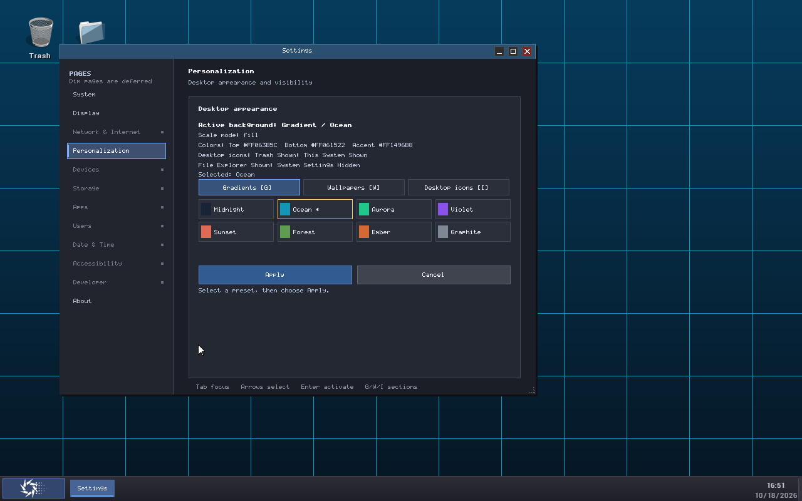

# guideXOS Server — Phase S20 Modifier-Aware Focus Acceptance

**Status: Outcome B — Partial.** The modifier-aware input path, shared reverse traversal, regression suites, freestanding production build, and real guest Shift+Tab checks pass. The complete ordered lifecycle was exercised on the immediately preceding S20 ELF; the corrected final ELF received the focused Tab/Shift+Tab/release/boundary checks but not the entire lifecycle sequence. A 660×440 production guest focus run was also not qualified because the calibrated QMP resize gesture did not change the window size. These evidence gaps keep S20 at Outcome B; no S9, Settings 1.0, or Server v0.3 acceptance is inferred.

## Repository and scope

- Repository: `D:\dev\guideXOSServer`
- Branch: `main`; starting HEAD: `492c10542c50281cf1ddc5b671d8eeae987e45fc`.
- Work stayed on `main`. No push was performed. Existing unrelated untracked evidence and output artifacts were preserved.
- S19R3 remains the accepted Settings UI baseline. S20 changes keyboard modifier delivery and Personalization focus traversal only; it does not enable deferred Settings categories or change configuration policy.

## 1. Existing keyboard architecture and exact loss point

The production PS/2 decoder consumes set-2 make and break sequences (`0xF0` is the break prefix), tracks Ctrl and Alt, translates ordinary scancodes to the legacy ASCII/special-key values, and queues Native ELF key transitions. Before S20, Shift used one boolean for both physical keys. It affected shifted ASCII, but Tab remained the same logical `\t` key. The legacy desktop API returned only the translated key value.

The loss occurred on the legacy path at `ps2keyboard::get_key()` → `desktop::handle_key(key)` → `KernelCompositor::handleKeyDown(key)` → `KernelApp::onKeyDown(key)`: the app callback had no modifier argument, and ASCII Tab alone cannot distinguish Tab from Shift+Tab. Native ELF already represented key identity and Down/Up in an internal queue, and its existing `gx_event` parameters already had room for modifiers; however, the bridge sampled current modifier globals while dequeuing instead of carrying the event-time snapshot. S20 fixes both paths at the decoder boundary.

The logical special keys (arrows and function keys) retain their existing values. Printable keys continue to use the existing Shift/Caps translation. The desktop legacy path still dispatches key-downs only; Native ELF continues to receive key-down and key-up transitions. Typematic repeat is represented as repeated key-down makes; there is no separate repeat bit.

## 2. S20 modifier and callback contract

- `ShiftState` stores independent left- and right-Shift make/break state. Effective Shift is true while either side remains held.
- Modifier make/break codes update decoder state and do not enqueue ordinary printable characters.
- Each queued non-modifier `KeyEvent` contains the existing logical `key`, `KeyAction` (`Down` or `Up`), and a Shift/Ctrl/Alt bit snapshot. The legacy key queue snapshots modifiers on key-down so the desktop cannot observe a later state after the key has already been consumed.
- The compatibility accessor `get_key()` and old `onKeyDown(uint32_t)` callback remain available. `get_key_with_modifiers()` adds a snapshot; `KernelCompositor::handleKeyDownWithModifiers()` reaches the new virtual `KernelApp::onKeyDownWithModifiers(key, modifiers)` callback. Its base implementation calls the old callback, so existing applications keep their behavior. The old compositor entry point forwards a zero modifier mask.
- Native ELF still maps key, action, and modifiers to the existing `gx_event` fields (`param1`, `param2`, `param3`). The public ABI structure, field sizes, and ABI revision are unchanged.
- No app-local Shift flag, Settings keyboard polling, heap-backed input queue, or parallel focus list was added.

## 3. Modifier ownership, focus, and lifecycle

The IRQ decoder is the authoritative owner of physical modifier state. Window focus changes, app destruction/reopen, and legacy app activation do not clear it. This avoids a stale per-app state and lets a held modifier remain visible across focus routing. `ps2keyboard::init()` resets the state during driver initialization. A missed hardware break can leave a modifier held until its break is received or the driver is reinitialized; S20 adds no timeout or focus-based reset that could incorrectly discard a physically held Shift.

Left/right Shift overlap and release ordering are directly exercised through the production decoder test. Control and Alt state semantics remain in the existing decoder and are included in event snapshots. Left/right Alt behavior and Alt+F4 shortcut state remain as before.

## 4. Shared bidirectional focus policy

The Settings adapter passes the Shift snapshot to `SettingsPresentationCore::moveFocus(reverse, eligibleCount, context)`. The shared core walks its existing fixed traversal order, counts only controls eligible in the current page/capability state, skips disabled or absent controls, wraps at either end, and sets focus to the last eligible entry for an initial reverse traversal. An empty eligible set clears focus. The existing focus state and indexed preset control remain authoritative.

Tab still accepts both ASCII `0x09` and `shell::KEY_TAB`; Shift+Tab uses the same core with `reverse=true`. Focus rings are repainted after traversal. The active Personalization sub-tab remains separate from keyboard focus, and committed appearance remains separate from a pending selection. Enter/Space activation, arrows, Escape, category navigation, and existing desktop shortcuts retain their existing handling.

## 5. Compatibility and production UI behavior

- Existing apps that only implement `onKeyDown(uint32_t)` continue through the base compatibility callback.
- The existing `gx_event` ABI layout and version are unchanged; Native ELF receives the event-time modifier snapshot through a field already used for modifier flags.
- Personalization supports keyboard focus movement among gradients, wallpaper paging/presets, and desktop icon controls. Disabled wallpaper Previous is skipped. Keyboard focus does not apply gradients, wallpapers, or icon changes by itself; Apply remains an explicit activation and Cancel discards pending state.
- Supported categories remain System, Display, Personalization, and About. Deferred categories remain unavailable and do not accept new configuration operations.

## 6. Tests and regression results

The focused PS/2 test links the production `ps2keyboard.cpp` IRQ decoder and checks left/right Shift independently, overlap/release ordering, repeated makes and breaks, Shift+Tab snapshots, key-up snapshot state, ordinary Tab after release, Enter, Space, Escape, arrows, F12, and unknown scancodes. The shared core suite covers wrap and reverse symmetry, ineligible controls, empty/single/indexed controls, and 1,000 mixed focus transitions. The native runtime suite retains 100 lifecycle repetitions, 250 provider refresh cycles, and 1,000 event/state transitions.

| Suite | Result |
|---|---:|
| PS/2 production decoder modifier test | 28/28 passed |
| S10 Settings presentation core | 3,659/3,659 passed |
| Native Settings runtime | 1,419/1,419 passed |
| Native Settings layout | 1,037/1,037 passed; 1,000 resize geometry transitions |
| Hosted Settings Center model | 89/89 passed |
| Compositor pointer buttons | Passed |
| Compositor resize notifications | Passed |

The individual executable transcripts are committed in [the S20 evidence directory](evidence/settings-s20-modifier-focus-20261018/README.md). Existing compiler warnings were inspected: the normalized file-plus-warning signature count is unchanged from the S19 comparison (224 before and 224 after), with zero added or removed signatures; no new S20 warning signature was found.

## 7. Production build and symbol audit

The ordinary AMD64 production kernel was built with freestanding settings, including `-ffreestanding`, `-fno-exceptions`, `-fno-rtti`, `-nostdlib`, and `-nostdinc++`.

- Compile commands: 257; compiler errors: 0; warning diagnostic lines: 463.
- Normalized file/warning signatures: 224, matching the S19 baseline count.
- Final ELF: 2,770,944 bytes; SHA-256 `9495CCB3670C94F4C2AEAA321113858DC57C53C79876E89B56C191D1002BB9B3`.
- Final PE: 2,887,206 bytes; SHA-256 `4042D82FF7B6100D0B0843FD3679D2A745A6DA94227CC0E412A027F702D47E22`.
- ELF undefined symbols: 21, equal to the S19 baseline; no added or removed undefined symbols.
- PE import directory, bound-import, IAT, and delay-import sizes are zero.

The final build summary and full compiler log are in the evidence directory. The production kernel and private guest boot media remain in the preserved `out/validation` build/output tree.

## 8. Production guest evidence

QEMU processes were inspected before launch. The foreign guest owned by `C:\gxR2` was left untouched. S20 used a private writable raw FAT image, the accepted read-only OVMF image, and private QMP endpoints. Both task-owned guests were stopped through their QMP endpoints. The final corrected-kernel launch record contains the kernel/media identities and pre/post media hashes.

The complete ordered guest interaction ran on the immediately preceding S20 kernel build. It demonstrated Start → Settings, Personalization, forward and reverse focus, disabled wallpaper Previous skip, wallpaper paging, icon controls and Apply/Cancel focus, System/Display/About, close/reopen, legacy Control Panel, Alt+F4 close, and return to desktop. That kernel differed from the final ELF only by a follow-up change moving the default compatibility callback out of line to remove one new unresolved symbol. The corrected final ELF was then booted and visibly checked for Tab, Shift+Tab returning focus, ordinary Tab advancing after Shift release, reverse traversal across the wallpaper disabled-control boundary, and a stable desktop.

The final-kernel screenshots show the yellow focus ring advancing and returning after a real QMP `sendkey shift-tab`; the QMP transcript records the injection and subsequent ordinary Tab. The decoder test independently verifies the make/break snapshot semantics. QMP text alone is not treated as proof of delivery.

| Evidence | What it demonstrates |
|---|---|
| [Final-kernel Tab](evidence/settings-s20-modifier-focus-20261018/final-kernel.focus-tab.png) | Forward focus reaches Aurora. |
| [Final-kernel Shift+Tab](evidence/settings-s20-modifier-focus-20261018/final-kernel.focus-shift-tab.png) | Reverse focus returns to Ocean through production input and callback routing. |
| [Tab after Shift release](evidence/settings-s20-modifier-focus-20261018/final-kernel.focus-tab-after-shift-release.png) | Normal forward traversal resumes. |
| [Wallpaper reverse boundary](evidence/settings-s20-modifier-focus-20261018/final-kernel.wallpaper-reverse-boundary.png) | Reverse traversal skips disabled Previous and reaches the preceding eligible section. |
| [Apply and Cancel focus sequence](evidence/settings-s20-modifier-focus-20261018/production-sequence.icons-apply-focus.png), [reverse](evidence/settings-s20-modifier-focus-20261018/production-sequence.icons-apply-reverse.png) | Keyboard can reach Apply/Cancel and reverse between them. |
| [Reopened Settings](evidence/settings-s20-modifier-focus-20261018/production-sequence.settings-reopened.png), [legacy Control Panel](evidence/settings-s20-modifier-focus-20261018/production-sequence.legacy-control-panel.png), [stable desktop](evidence/settings-s20-modifier-focus-20261018/final-kernel.stable-desktop.png) | Lifecycle evidence from the preceding build and final-kernel desktop finish. |

## 9. Configuration safety

Keyboard navigation and focus did not apply pending Personalization choices. The final launch's `DESKTOP.CFG` pre-run and post-run records both report 234 bytes and SHA-256 `CF310FEA3047F36350F99DB5E2FF458A20E85E6AAE9449F320BFE57F14967249`. The extracted 234-byte snapshots from the prior S20 private image and final image also compare byte-for-byte equal. This is a file-level comparison, not an inference from the whole ESP hash.

## 10. Resize qualification and limits

The S20 QMP run attempted the calibrated lower-right held-button resize gesture at the ordinary 760×560 Settings size. Screenshots captured the target, held attempt, and final state; the window stayed at 760×560. The S20 guest therefore did not establish focus or clipping at the accepted 660×440 minimum. This result is a harness/guest qualification limit, not evidence of a resize code regression. S19R3's accepted minimum-size evidence remains historical and was not reused as S20 keyboard evidence.

The full multi-page and lifecycle guest sequence was not repeated on the corrected final ELF. The final ELF did receive focused real guest modifier and traversal checks, and all regressions and the production build used the corrected source.

## 11. Recommended S21 follow-up

1. Qualify the QMP held-button resize procedure or another guest-observable pointer path, reach 660×440, and repeat representative Personalization Tab/Shift+Tab and enabled-control traversal there.
2. Repeat the full ordered keyboard, Personalization, close/reopen, and legacy Control Panel sequence on the exact final production ELF, capturing its config pre/post record.
3. If future diagnostics need to prove physical break ordering beyond the current real focus result plus decoder test, add narrowly scoped PS/2 make/break telemetry and preserve that transcript.

No new Settings category or unrelated policy work is recommended for S21.
