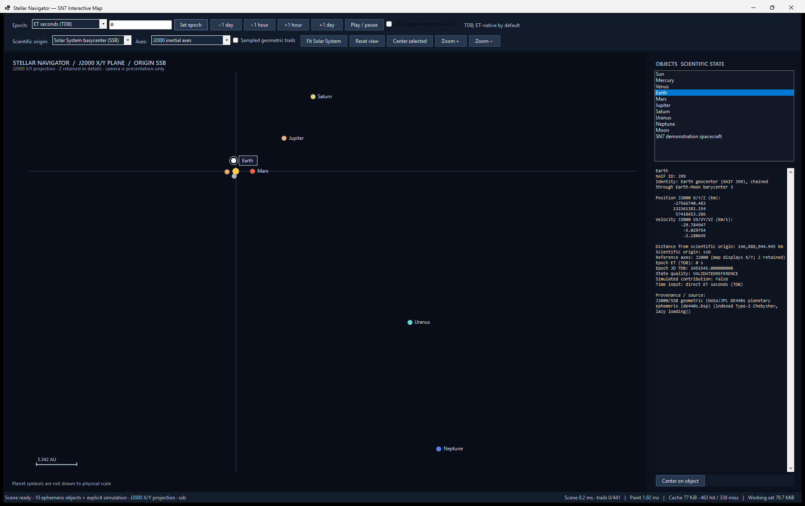

# Stellar Navigator — SN7 Interactive 2D Map

**Status:** Accepted hosted Windows implementation
**Branch:** `STELLAR_NAVIGATOR`
**Qualification:** Research and simulation software; not flight-qualified. SN7 does not implement native guideXOS Server UI integration.

SN7 adds the first runnable graphical Stellar Navigator map. It evaluates the bundled JPL DE440s Chebyshev ephemeris at an explicit ET epoch and plots actual state positions. The map is a physical-scale, top-down projection of the selected reference frame's **X/Y plane**. Z remains part of every state and appears in the details panel. This is neither an ecliptic projection nor a 3D view.



## Projects and architecture

The solution contains two SN7 projects:

- `StellarNavigator.Scene` targets portable `net8.0`. `SceneBuilder` consumes the ET-native `IEtEphemerisProvider` and SN6 `FramedStateService`, and returns scene objects with their scientific states, quality, provenance, origin, frame, and optional trails. `Camera2D` and `EpochInputResolver` are platform-independent. This layer does not reference a GUI framework or accept camera state when building a scene.
- `StellarNavigator.Gui` targets `net10.0-windows` and uses Windows Forms. This was the smallest supported Windows desktop option available in the installed .NET toolchain and adds no rendering package. It loads the existing ephemeris, authenticated SN5 leap-second, and SN6 orientation files from its local `Data` directory.

`SolarMapControl` renders an already-built scene. `MainForm` owns input controls, selections, asynchronous scene requests, and diagnostics. Epoch, scientific origin, and frame changes request new scientific states; camera pan and zoom reuse the current scene. Scene generation runs away from the UI thread, cancels superseded requests, and accepts a result only when its generation ticket is current. A selection only changes the displayed details and highlight. Camera position is never used to construct spacecraft or celestial states.

## Build and launch

From the repository root on Windows with the .NET 10 Windows Desktop runtime:

```powershell
dotnet build Apps/StellarNavigator/StellarNavigator.slnx -c Release --artifacts-path Apps/StellarNavigator/.sn7-validation
& Apps/StellarNavigator/.sn7-validation/bin/StellarNavigator.Gui/release/StellarNavigator.Gui.exe
```

The build copies the three required data assets beside the executable under `Data`. The ephemeris is essential. If it cannot be loaded, the window presents a diagnostic and leaves the rest of the process intact. Time conversion and Earth orientation are optional dependencies: a missing/invalid leap-second file disables UTC input, and a missing/invalid orientation file disables the IAU_EARTH option while J2000 remains available. No dataset download is attempted.

## Map and navigation

The map uses the current scientific frame's X/Y coordinates and preserves physical spacing. It draws a scale bar in AU. Planet symbols are fixed-size screen-space navigation symbols; the Sun and planets are **not drawn to physical diameter scale**. Small bodies can be crowded together in the full-system view. Markers retain a minimum hit size, the selected object receives a readable callout, and nearby nonselected labels are suppressed where needed. Zooming in reveals the inner-system geometry without changing interplanetary distances.

The camera keeps its center and scale in binary64. For each point it subtracts the camera reference from the scientific coordinate before scaling, and converts to screen coordinates only at the drawing edge. Non-finite or overflowing transforms are rejected. Scale is clamped between `1e-20` and `1e-2` pixels per meter. Pan, zoom, fit, and selection do not change any `CartesianState`.

| Action | Input |
|---|---|
| Zoom at pointer | Mouse wheel |
| Pan | Drag the map |
| Select | Click a marker; the object list also selects objects |
| Fit current scene | **Fit Solar System** or `F` |
| Reset camera | **Reset view** or `Home` |
| Center selected object | **Center selected** or **Center on object** |
| Zoom around the view center | **Zoom + / Zoom −**, `+ / −` |
| Pan | Arrow keys |
| Cancel an active drag | `Escape` |

The main window is resizable and has a minimum size of 1180 × 720 pixels. The map and state panel remain in a split layout.

## Supported objects and DE440s identities

The default scene requires the Sun and all eight planets. The bundled data also supports the Moon. SN7 keeps the exact supported target identifiers and does not substitute an unavailable planet center with a fabricated state.

| Display name | NAIF ID | Dataset identity shown in details |
|---|---:|---|
| Sun | 10 | Sun body center |
| Mercury | 1 | Mercury system barycenter; center 199 is coincident under this DE440s convention |
| Venus | 2 | Venus system barycenter; center 299 is coincident under this DE440s convention |
| Earth | 399 | Earth geocenter, chained through Earth–Moon barycenter 3 |
| Moon | 301 | Moon body center, chained through Earth–Moon barycenter 3 |
| Mars | 4 | Mars system barycenter; center 499 is unavailable |
| Jupiter | 5 | Jupiter system barycenter; center 599 is unavailable |
| Saturn | 6 | Saturn system barycenter; center 699 is unavailable |
| Uranus | 7 | Uranus system barycenter; center 799 is unavailable |
| Neptune | 8 | Neptune system barycenter; center 899 is unavailable |

Each selected-object panel reports identity/classification, J2000 or IAU_EARTH position X/Y/Z in km, velocity VX/VY/VZ in km/s, distance from the **scientific coordinate origin**, frame, origin, ET and JD TDB, source/provenance, state quality, and whether the state is simulated. The map camera center is explicitly described as presentation-only.

## Time input and stepping

- **ET seconds (TDB):** the default and preferred input. The text value is passed to the ET-native ephemeris path directly; it is not reconstructed from a Julian date.
- **JD TDB:** accepted as a binary64 Julian date. The details identify this representation and warn that near modern dates its precision is limited to tens of microseconds.
- **UTC:** converted only through the authenticated SN5 leap-second table. UTC beyond the last announced leap-second data is refused in strict mode. The user must enable **Allow provisional future UTC** to opt in. Provisional conversion is labeled as such and downgrades scene quality to stale data; the simulated flag remains separate. The computer's local timezone is not used as a scientific time scale.
- **Step controls:** −1 day, −1 hour, +1 hour, and +1 day add directly to ET. Playback advances one minute of ET per 250 ms timer tick, skips ticks while a build is in flight, pauses at a coverage boundary, and can be stopped with **Play / pause**.

Invalid/non-finite input and refused UTC conversion produce a visible diagnostic and preserve the last valid scene. The window starts at ET 0 (J2000 epoch); no “today” conversion is implied.

## Origins, frames, and demonstration spacecraft

- **Solar System barycenter (SSB):** J2000 axes, SSB scientific origin.
- **Earth geocenter:** J2000 axes, Earth origin. Earth is exactly at (0, 0, 0) in this mode.
- **Simulated spacecraft:** J2000 axes, an explicit `SN7-DEMO` origin. Its synthetic state is initialized for every requested ET from the evaluated Earth state: +42,164 km along J2000 Y and +3.0746 km/s along J2000 X relative to Earth. It is not propagated and is not telemetry. It carries simulated provenance and `ApproximateOrSimulated` quality. Celestial states in this mode pass through the SN6 origin-compatibility service; the spacecraft reference marker is at zero.
- **IAU_EARTH axes:** an optional low-precision cartographic demonstration, available only with Earth origin and an authenticated `earth_orientation.sn6json` model. State velocities include the rotating-frame transform. This is not ITRF93 or a high-precision terrestrial frame. If the asset is missing or invalid, only this option is disabled; J2000 remains usable.

The camera never moves the simulated spacecraft. Camera pan/zoom and scientific origin are separate state. Moving the camera left the selected body's ET, position, and velocity unchanged during GUI interaction.

## Orbital trails

**Sampled geometric trails** are optional and are evaluated from the same DE440s data at explicit ET values. For each object with a nominal sampling period, the builder samples one nominal period centered on the requested epoch, at 48 equal ET intervals (49 points maximum per object). The period determines the sampling span and spacing; every plotted point is an ephemeris query, not an idealized ellipse. At most nine bodies have periods (eight planets plus Moon), so the scene-wide limit is 441 samples. Samples are clipped to available coverage (and to the shared Earth coverage for Earth-origin trails), kept in ET order, and unavailable samples are omitted rather than extrapolated.

This is a bounded overview trail, not an adaptive integrator. The 48-interval spacing has no guaranteed chord-error or visual-fidelity tolerance. Short coverage near a dataset edge can produce a partial trail. Trail calculation is canceled with an obsolete scene build, not repeated for camera-only navigation.

## Quality, provenance, and failure behavior

Validated DE440s states retain `ValidatedReference` quality and source identity. The simulated spacecraft retains its simulation flag and approximate/simulated quality. Provisional UTC conservatively marks otherwise successful scene states stale and adds the leap-second-table provenance. Direct ET and JD TDB paths are independent of UTC uncertainty. Orientation provenance names the authenticated SN6 model when used.

Essential planet coverage is checked before scene creation. Missing required targets, unsupported frames/origins, out-of-range ET, corrupt/missing orientation, and failed ephemeris evaluations return explanatory errors. No data are extrapolated beyond coverage. A canceled or older asynchronous build cannot replace the current scene. The GUI keeps the last valid scene visible for rejected epoch input.

The hosted runtime reads only bundled local assets. The GUI and scene projects contain no HTTP client, download, socket, or remote-data path; no automatic dataset retrieval is implemented. SN7 does not require Python, CSPICE, guideXOS SQL, or networking at runtime.

## Performance and runtime evidence

Measurements below are from the hosted Windows desktop and are not guideXOS qualification results. They are single-run observations, not performance guarantees:

| Measurement | Observed value |
|---|---:|
| Startup stopwatch (entry to `Main` through window shown) | 731 ms |
| Initial scene build | about 13.6 ms |
| Trail scene build | 3.4 ms for 441/441 samples |
| Typical map paint | about 1.3–2.1 ms; 1.92 ms in the final capture |
| Pan paint | about 1.7 ms in the interaction run |
| Working set | about 80 MiB at final capture (79.7–81.1 MiB across adjacent samples) |
| Ephemeris coefficient cache | configured default remains 4 MiB; observed 77 KiB resident, 463 hits / 338 misses in final view |

The runtime check opened the real WinForms window, listed the Sun, eight planets, Moon, and explicit simulated spacecraft, and exercised SSB/Earth/spacecraft origins, authenticated IAU_EARTH, ET entry and stepping, strict/provisional UTC, trail toggle, error diagnostics, resizing, fit, pointer-centered wheel zoom, drag pan, and mouse selection. Keyboard `F` invoked fit and the status reported a view update. Zoom changed the displayed scale from 3.342 AU to 1.337 AU. Clicking Uranus updated the state panel to NAIF 7. Pan and zoom changed the view while the selected scientific state remained unchanged. The window stayed responsive. Screenshot evidence is the actual captured application window above, not a generated rendering.

## Validation

SN1–SN6R baseline: **274 passed** before SN7 changes. The portable scene/camera/time tests add 20 cases, bringing the full suite to **294 passed**. They use the real deterministic indexed DE440s and authenticated orientation assets and do not require a display. Coverage includes scene state and body identity, origin/frame metadata, provisional time quality, ET precision/stepping, coverage rejection, sampled-trail limits/order, stale-build rejection, double-precision floating origin, project/unproject, zoom bounds and pointer anchoring, pan/state independence, hit testing, fit bounds, and non-finite values.

The complete solution built in Debug and Release with **0 warnings and 0 errors**. All 294 tests passed in both configurations. Builds and tests used the isolated `--artifacts-path` shown above so the pre-existing tracked `bin`/`obj` outputs were not overwritten. Actual GUI launch, mouse/keyboard interaction, and resize were verified on the host.

## Limitations and next phase

SN7 is a hosted Windows application. It does not qualify or implement a native guideXOS Server GUI. The map is a 2D projection with no arbitrary 3D camera, light-time correction, planet-center kernels for unsupported bodies, Pluto, real spacecraft telemetry, attitude, sensors, mission-control networking, trajectory optimization, or flight use. Trails are fixed-interval sampled trajectories without an error bound. IAU_EARTH is limited to the authenticated low-precision SN6 model.

**Recommended SN8 scope:** define and validate a guideXOS-native presentation adapter for the portable scientific scene contract, with bounded native drawing resources and explicit data-quality/provenance mapping. Keep the ET, origin, frame, and simulation contracts unchanged. Add host-kernel compilation checks and a native display acceptance harness before claiming guideXOS integration. Separately, improve trail fidelity with an explicit geometric error budget and adaptive subdivision only if that can be bounded within the target runtime's resource model.
