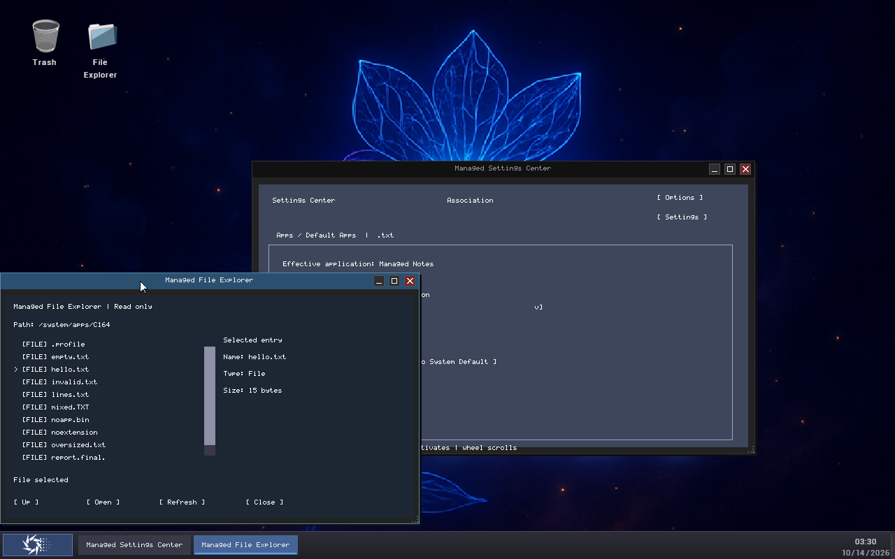

# NativeAOT C173 Managed File Explorer Live Resizing

**Repository:** `D:\dev\guideXOSServerV1.1_DOTNET_SUPPORT`

**Branch:** `v1.1_DOTNET_SUPPORT`

**C173 implementation starting HEAD:** `36e99731f014d6bf3ee9b4ecbf27ed8bb69e3cc6`
**C173R1 acceptance starting HEAD:** `8c1859fd7e8f8c3d17b0ae61942012b9ed942e66`
**Current qualification:** implementation, host regression, three focused guest boots, three historical ordinary production boots, and one supplemental proof-disabled ordinary production concurrency boot PASS. Outcome A; the C173R1 evidence closes the prior concurrent-resize acceptance gap.

## 1. Starting state and protected media

The expected C172 starting commit and branch were present. The current local upstream tracking ref was 0 ahead / 0 behind at the start. The only initial worktree modification was the inherited unstaged `ESP/ramdisk.img`.

The installed C172 ramdisk hash was `A5ABC0F25764AAA3C269A30E129C20DB15E345D0255A9BE85D31EC3C13CCFA2D`. The protected C171 ramdisk backup remains `2DD5D7195C1A18098B3DDEAB0B680AC8B0B2C861ED45C5C924BFC684F9C06334`. The protected canonical and ESP kernel backups both remain `BCBD5EC563915C84391B6CED09718CF787A29BA30D0CCADF13DEC1DECB6CB874`.

The earlier accepted C173 proof-disabled installation replaced the installed ramdisk with the production candidate whose hash is `AABE4E849B4FB7E4C47E0CA0D573C753879DB8612449DA39E848964E7A726FD8`. Its canonical and ESP kernel hashes are both `9F3091916D7CB6C109BB5D71B65E1D7F1047AB576C8C994105179ECCB6E6A8F1`. The installed `ESP/ramdisk.img` remains a visible worktree change and must not be staged with source files.

## 2. Architecture audit and shared resize path

C163 uses selector 8 and app identity `com.guidexos.apps.managed.fileexplorer`. `ManagedFileExplorerC163` owns the existing controller, VFS-backed directory browser, selection, list, buttons, status/path labels, and managed surface. `GuideXosManagedFileExplorerC163` owns the current rectangles and uses the existing `GuideXosListBox` and `GuideXosVerticalViewport`. C164/C166 remains the single file-activation and association route.

C173 extends the C172 route to selector 8 with the exact Managed File Explorer surface check. The native path remains:

```text
KernelCompositor resize-corner drag
  -> NativeAotApplication::onWindowResize
  -> invokeManagedAction
  -> ManagedFileExplorerC163.HandleAction
  -> existing controls and ListBox layout
```

The compositor continues to own native bounds, pointer capture, clipping, and rollback. Managed Explorer validates its application bounds, recomputes layout in place, and accepts or rejects the candidate. Rejection restores the old native and managed bounds. Settings continues through its existing C172 action route. No dispatcher, ABI slot, window manager, focus authority, application lifecycle, or rendering backend was added.

The runtime reserves multiple managed surface slots. `launchLogicalApplication` focuses an existing surface by app identity and otherwise reserves another slot. Focused guest proof boot 3 confirmed Settings and Explorer could stay open concurrently, retained distinct window IDs, and returned focus to each existing surface after the other was resized.

## 3. Geometry and adaptive layout

The default Explorer outer window is 800×390, including a 24-pixel title bar; its client is 800×366. The application resize bounds are:

| Geometry | Outer window | Client area |
|---|---:|---:|
| Minimum | 600×360 | 600×336 |
| Default | 800×390 | 800×366 |
| Maximum | 960×526 | 960×502 |

The generic compositor minimum remains unchanged. Supported live guest transitions were 800×390 → 960×526 → 600×360 → 800×390. Unsupported 599×360 and 599×359 requests were rejected and rolled back.

Layout updates the path/details labels, list viewport, buttons, status label, and scrollbar using the current client size. The ListBox has 59 columns and 12 visible rows at default size, 34 columns and 10 rows at minimum, and 79 columns and 16 rows at maximum. The stored path and names remain intact while drawing clips text to the current control width. Long-name/path clipping is covered by host cases.

The list and scrollbar share `GuideXosVerticalViewport`. The scrollbar is pointer-only and nonfocusable, preserving the existing Tab and Shift+Tab order. Visibility follows whether the directory has more rows than the viewport can show. Wheel, thumb drag, pointer row selection, and keyboard scroll-into-view use current rectangles. Reapplying identical dimensions is deterministic and does not rebuild the controller, browser, list, or label storage.

The frame has a fixed six-control host capacity, including the scrollbar. Native rectangle storage remains fixed at eight entries. The frame uses one managed background rectangle and at most the existing scrollbar track and thumb. Row text uses a bounded stack buffer; the host stress run reported zero hot-path allocation bytes and zero layout drift.

## 4. State, input, and resize transactions

Resizing is presentation-only. It does not navigate, refresh, enumerate the directory, create another surface, or replace the controller. Selection stays attached to the existing ordered entry snapshot. The viewport retains or safely clamps its offset, and selected rows remain reachable. Pointer hit testing uses the updated list and scrollbar bounds. Keyboard behavior remains the existing Tab, Shift+Tab, Up, Down, Home, End, and Enter behavior.

C163 has no popup or modal UI. Resize leaves no popup or capture owner. The scrollbar's existing pointer capture is separate from the compositor's resize-corner ownership. Layout and render invariants determine acceptance; on rejection, the previous layout and scroll position are restored.

Focused guest boot 2 opened `/system/apps/C151`, reached a nonzero scroll offset, selected an entry, expanded and reduced the same window, checked the current pointer row, used keyboard navigation, and restored the layout. Focused boot 1 and boot 3 verified the `/system/apps/C164/hello.txt` selection across resize and rejection. Focused proof boot 3 also verified concurrent app isolation:

- Settings identity: generation `00000002`, window `000003E9`.
- Explorer identity: generation `00000003`, window `000003EA`.
- Explorer resized while Settings remained open; Settings geometry remained 720×420 and its pending `Disabled` association choice was not persisted.
- Settings resized through C172 from 720×420 to 512×222 and back while Explorer remained open at 600×360 with `/system/apps/C164/hello.txt` selected.
- Focus returned to each existing surface. Closing Explorer left Settings open; the existing Apply/Reset path then finished at `NoOverride`.

The exact concurrent screenshot paths and hashes are in `c173-focused-proof-manifest.json` under `focusedBoots[2].explorer.crossApplication.screenshots`.

## 5. Host and focused guest validation

`GuideXosManagedWindowResizeC173Tests` adds 47 focused cases for bounds, deterministic layout, state and object identity, no filesystem work during resize, viewport clamping, pointer hit testing, keyboard navigation, scrollbar behavior, lifecycle, and clipping. The stress group ran 1,000 layout updates, including 500 alternating sizes, 500 selection transitions, 250 scroll operations, 250 keyboard operations, 100 navigation/resize combinations, and 100 lifecycle cycles. It reported zero failed cases, zero drift, and zero hot-path allocation bytes.

The consolidated regression manifest reports 22 suites / 710 cases, including the 47 C173 cases and C173 stress checks. The C172 resize host suite also passed 43 cases and seven stress checks.

The focused manifest reports three independent guest boots PASS, outcome A. Serial SHA-256 values:

| Focused boot | Serial SHA-256 |
|---|---|
| Boot 1 | `628B67F2FCF1F35B9FD6DF82F21692577C45CF16783FA8A1D76ABAF2C3957BA8` |
| Boot 2 | `FB4638AF08865015E29E382B6E099C7302923938F2FB376D3D0DD6BA3ADF83AE` |
| Boot 3 | `0FDAB4C6EAAD5688BCD4C3AD16B17511FFE59717677E687E6AB13CC65CF9BC6F` |

Focused boot 3 also passed C164 Notes activation with canonical path `/system/apps/C164/hello.txt`, exact content `hello from C164`, 15 bytes, clean baseline, and zero undo/redo. Settings C172 resize and Apply/Reset, Calculator `7 × 8 = 56`, Task Manager, and Explorer close/reopen passed.

## 6. Earlier proof-disabled production acceptance

The prior C173 production acceptance manifest reports a clean proof-disabled NativeAOT composite, kernel, and ramdisk build; installation PASS; and three independent ordinary boots PASS. Artifact hashes were:

| Artifact | SHA-256 |
|---|---|
| NativeAOT composite | `AC80EC2937F55FE2AD828DDFBCAB7419A9BFB015B7B69B71C8FA01FB7CBBB637` |
| Canonical and ESP kernel | `9F3091916D7CB6C109BB5D71B65E1D7F1047AB576C8C994105179ECCB6E6A8F1` |
| Installed production ramdisk | `AABE4E849B4FB7E4C47E0CA0D573C753879DB8612449DA39E848964E7A726FD8` |

Ordinary serial hashes in that accepted run were `697AB5D5E57FCE886E26B7AA8586C0FF7F17B97399D52CE465F2D0D14B482EB5`, `970AB3E62037721985D41109435AECCB7EF44C1B7A7BFB7F46BE2F8D5086745E`, and `2AC29A0313F9D92DFDA6EDD0B88A39EFD0B3496022947EB871AD4302DAF8F935`.

Those three historical ordinary boots exercised C173 Explorer resizing and the existing C163/C164/C172 regressions. They preceded the simultaneous Settings/Explorer scenario and remain unchanged. C173R1 adds a separately identified ordinary proof-disabled production boot below; it does not rewrite or reinterpret any historical boot record.

## 7. C173R1 supplemental ordinary production concurrency boot

C173R1 started from `8c1859fd7e8f8c3d17b0ae61942012b9ed942e66` on `v1.1_DOTNET_SUPPORT`. Preflight found no running QEMU process, including no process matching the previously reported PID 29388. The run used an isolated ESP under `out/dotnet/c173-file-explorer-resize/production-acceptance/supplemental-concurrency-run-20261014-032606-0c241772/ordinary-boot-03`; no other workspace or QEMU media was reused. QEMU PID 10584 started at `2026-10-14T03:26:08.2088824Z`, using `C:\Program Files\qemu\qemu-system-x86_64.exe`. Its complete command-line arguments, isolated ESP, process identity record, and QMP endpoint are recorded in the supplemental manifest.

The ordinary guest used the previously validated production media without rebuilding or replacing it:

| Artifact | SHA-256 |
|---|---|
| NativeAOT composite | `AC80EC2937F55FE2AD828DDFBCAB7419A9BFB015B7B69B71C8FA01FB7CBBB637` |
| Kernel | `9F3091916D7CB6C109BB5D71B65E1D7F1047AB576C8C994105179ECCB6E6A8F1` |
| Ramdisk | `AABE4E849B4FB7E4C47E0CA0D573C753879DB8612449DA39E848964E7A726FD8` |

Proof-only diagnostics were disabled: `proof1` was excluded, the C172/C173 geometry and proof markers were absent from the composite, kernel, ramdisk, and serial log, and the guest ran the ordinary production application paths.

The concurrent window identities observed in the production serial log were:

| Application | Managed instance | Generation | Window |
|---|---|---|---|
| Settings | `0000000000000007` | `00000007` | `000003EE` |
| File Explorer | `0000000000000008` | `00000008` | `000003EF` |

Settings opened at 720×420. With Settings open, Explorer navigated to `/system/apps/C164`, selected `hello.txt`, and resized 800×390 → 960×526 → 600×360. Explorer kept the same instance, generation, and window; Settings stayed at 720×420. The selection and path were retained. Settings then resized 720×420 → 512×222 → 720×420 while Explorer remained at 600×360 with `/system/apps/C164/hello.txt` selected. Surface identities stayed stable and focus returned successfully to each window.

An additional simultaneous boundary check verified out-of-bounds rejection and state rollback. Explorer rejected 599×359 from 600×360 and remained at 600×360 with `hello.txt` selected. Settings rejected 511×221 from 512×222 and remained at 512×222; its measured lower border stayed at pixel row 451 both before and after rejection. Settings then restored to 720×420. With both windows open, Explorer hit testing after rejection, ListBox End/Home keyboard navigation, the 11-entry view change, and selection restoration passed. This boundary check used Settings instance `0000000000000007` / generation `00000007` / window `000003EE` and Explorer instance `000000000000000B` / generation `0000000B` / window `000003F2`; both were simultaneously visible in the captured desktop frame. In the same ordinary boot, the 15-entry `/system/apps/C151` resize characterization also kept its selected entry and scroll viewport through 960×526, 600×360, and 800×390; pointer hit testing and Up/Down navigation passed, with scroll offsets 3, 3, and 5 recorded.

Settings association behavior remained correct: the pending `Disabled` choice did not persist during resizing, the existing Apply operation reported `Disabled`, Reset returned to `NoOverride`, and reentry showed `NoOverride`. Production integration also opened `/system/apps/C164/hello.txt` in managed Notes and verified the exact 15-byte text `hello from C164`; Calculator displayed 56 and Task Manager launched and refreshed successfully.

The dual-window screenshot shows the selected C164 file and both managed windows at once:



The actual production serial log SHA-256 is `D00516F939A0F0BA476BDEC4D75B81EDD5DBA6AB0862543A94E83E42552A9151`; the QMP input log SHA-256 is `DCB5C255E4EC3293E3B4F70F5C35D7DE9F76C4A0BABCA9240F8E801EE898186D`. The source run manifest SHA-256 is `087B2CC4EE0E09F414B3FA31594952E245DD0F271DF29EE97A5978CB58507332`. The detailed tracked result is [C173R1_PRODUCTION_CONCURRENCY_ACCEPTANCE.json](C173R1_PRODUCTION_CONCURRENCY_ACCEPTANCE.json). The ignored historical manifest was preserved byte-for-byte before update (SHA-256 `47C9E91618648E393A9E8C78CEFC5AAD6DF1CDAE75B2C20955E855AFAD7D2931`) and now records one explicitly supplemental concurrency boot; its original three ordinary boot entries remain unchanged.

## 8. Compatibility and remaining status

The host ABI remains version 4 with a 128-byte table; snapshot, close, and association callbacks remain at offsets 104, 112, and 120. C166 remains the single association authority with its 328-byte response and version-2, 136-byte dual-slot storage. Settings persistence remains `GXSETT.BIN`, version 2, 26 bytes. The final previously accepted association state is `NoOverride`, with effective handler `com.guidexos.apps.managed.notes`. No Native Notepad eligibility change was made. C128 remains unverified.

The C173 implementation and proof-disabled production acceptance are complete. C173R1 adds the ordinary concurrent Settings/Explorer evidence required for Outcome A. Evidence is stored under `out/dotnet/c173-file-explorer-resize/`: `host/managed-ui-host-manifest.json`, `c173-focused-proof-manifest.json`, the updated `c173-production-acceptance-manifest.json`, and the supplemental run directory referenced by `C173R1_PRODUCTION_CONCURRENCY_ACCEPTANCE.json`. C128 remains unverified and was outside this acceptance scope.
