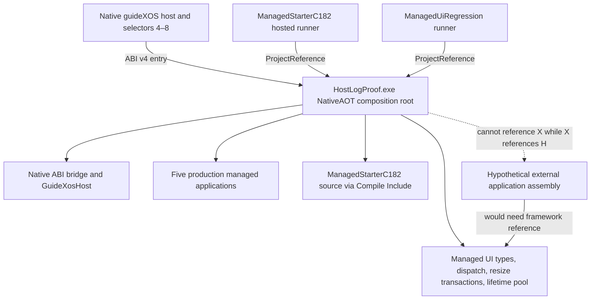

# C183 External Managed Application Authoring Boundary

**Classification:** Outcome C — architecture boundary documented
**Repository:** `D:\dev\guideXOSServerV1.1_DOTNET_SUPPORT`
**Branch:** `v1.1_DOTNET_SUPPORT`
**Starting HEAD:** `b6f986611f86b5f1bd29ba68089965b3182faed4`
**Scope:** Managed assembly, registration, NativeAOT, and packaging audit. No production runtime, registry, selector, kernel, or media changes.

## Decision

The current project can expose public C# types to a referencing project, but it does not produce a reusable managed UI framework assembly. The framework, native host bridge, static application registry, lifetime pool, and product applications are compiled together by `HostLogProof.csproj` as one NativeAOT executable.

The C182 starter is a separate source file and a separate hosted runner project. Its source is explicitly compiled into `HostLogProof`; the runner calls its hosted tests. It is not a separately compiled application assembly. The production host cannot also reference an application assembly that references `HostLogProof` without creating a project dependency cycle. The private static registry has no external registration entry point, and the C180/C174 resize contract is internal.

Making those hooks public would not solve the static composition problem. A supported external workflow needs a deliberate framework assembly boundary and a composition root that references both that framework and the application assembly. Extracting that boundary safely would cross the 142 C# files in the current `HostLogProof` project and its NativeAOT-specific startup, symbols, and packaging rules. C183 therefore records the boundary and a staged proposal instead of exposing implementation types or changing release architecture.

This result is not an installable third-party application SDK. It does not provide a dynamically loadable DLL, standalone application ELF, new process model, or guest-installable external application.

## Preflight and preserved state

- The checkout is `D:\dev\guideXOSServerV1.1_DOTNET_SUPPORT`, branch `v1.1_DOTNET_SUPPORT`, at the requested starting HEAD.
- The starting worktree had only the protected modified `ESP/ramdisk.img` and these three protected untracked directories: `samples/host/ManagedUiRegression/obj/`, `samples/host/ManagedStarterC182/obj/`, and `samples/managed/HostLogProof/c182-host-smoke/`. They were left in place.
- The ramdisk SHA-256 was `AABE4E849B4FB7E4C47E0CA0D573C753879DB8612449DA39E848964E7A726FD8` before work and was unchanged after the host builds.
- The C180, C181, C181R1, and C182 reports were read. The prompt's expected starting HEAD matched the actual HEAD. No repository `.phase` file or `AGENTS.md` was found.
- The QAC coordinator and GUI processes were present (PIDs 408 and 21476). A QAC CLI was not available on `PATH`; the preflight process census found no QEMU process. This documentation-only phase did not request a QAC reservation or run a guest.
- `D:` had about 16.0 GB free after the host checks. The installed .NET SDK is 10.0.402; .NET 9.0.21 is available for the repository's `net9.0` projects.

## Assembly and dependency audit

### Current dependency shape



| Project or source | Current role | Boundary finding |
|---|---|---|
| `samples/managed/HostLogProof/HostLogProof.csproj` | `net9.0`, `win-x64`, `OutputType=Exe`, `PublishAot=true`; compiles the host bridge, managed UI, application registry, lifecycle code, and product apps | This is the only project containing the reusable UI implementation. It is an application composition root, not a framework library. |
| `samples/managed/HostLogProof/GuideXos/*.cs` | Application base, host, surface, controls, input, dispatch, resize, and lifetime implementation | Most author-facing controls and callback types are public, but the resize and lifecycle integration pieces remain internal. All are emitted in the HostLogProof assembly. |
| `samples/managed/HostLogProof/Applications/*.cs` | Product applications and app-owned state | The five established production apps share the same project and static composition root. |
| `samples/host/ManagedStarterC182/ManagedStarterC182.csproj` | Hosted callback test executable | It references `HostLogProof.csproj`; it does not produce a separate managed application assembly. |
| `samples/host/ManagedUiRegression/ManagedUiRegression.csproj` | Existing managed UI host regression executable | It also references `HostLogProof.csproj`; this test boundary does not create a reusable framework assembly. |
| `samples/managed/ManagedStarterC182/ManagedStarterC182.cs` | C182 application example | `HostLogProof.csproj` has a `Compile Include` for this file, so the app type is compiled into the same assembly as its framework and registry. |

The public types can technically be used through a `ProjectReference` to `HostLogProof.csproj`, as the hosted runners already reference that project. That does not create a supported framework package or a one-way application integration path. If an external app project references HostLogProof, HostLogProof cannot statically reference that app back. If HostLogProof instead owns the app source, the app is no longer independently compiled.

A disposable compile probe under `out/dotnet/c183-architecture-audit/external-reference-probe/` confirmed the narrow fact: a separate `net9.0` project can reference the HostLogProof project output, derive from public `GuideXosApplication`, and construct public `GuideXosButton`. Its source is explicitly included in its own project. It uses the same HostLogProof `AdditionalProperties` as the C182 runner because the framework project has a conditional source set. A second explicitly compiled probe attempts the C180 override and fails with CS0122 because `GuideXosManagedWindowResizeBoundsC174` is inaccessible. Neither probe enters the static registry. These are audit checks, not a supported starter project or product integration. The build-configuration coupling is another reason not to publish HostLogProof as the application framework boundary.

### Public and internal API surface

| Capability | Current access | External-authoring consequence |
|---|---|---|
| Application lifecycle | `GuideXosApplication` and `Launch`, `HandleInput`, `HandleAction`, and `OnTearingDown` are public | An external class can derive from the base and implement the general callbacks when it references the HostLogProof assembly. |
| Host, surface, controls, input | `GuideXosHost`, `GuideXosSurface`, common control types, `GuideXosControlHost`, and `GuideXosInputEvent` are public | Existing controls and input routing can be called without copying their implementation. The project still provides no stable assembly/API versioning promise. |
| Redraw and state | Public host/surface and control methods; C182 keeps count and layout in its application instance | State ownership and redraw behavior are demonstrated by C182, but its source is compiled into the host assembly. |
| Resize opt-in | `GuideXosApplication.TryGetManagedResizeGeometryC180` and `HandleManagedResizeC180` are `internal virtual` | A separate assembly cannot override the C180 hooks. |
| Resize bounds and transaction | `GuideXosManagedWindowResizeBoundsC174`, `GuideXosManagedWindowResizeCandidateC174`, and `GuideXosManagedWindowResizeTransactionC174` are internal | Exposing the existing types directly would expose implementation details; a future public contract needs a narrow API adapter while retaining C174 acceptance and rollback semantics. |
| Resize dispatch | `GuideXosManagedWindowResizeDispatchC180` is internal and called from the managed application dispatch path | An external assembly cannot invoke or replace shared dispatch. Default-deny is enforced by the internal base hook returning `false`. |
| Descriptor and registry | `GuideXosApplicationDescriptor` and `GuideXosApplicationRegistry` are public types, but the descriptor array and registration code are private and statically initialized | `TryFind` is lookup, not registration. There is no `Add`, module initializer, reflection scan, or external factory table. `Dispatch` is a native host entry path, not an app registration API. |
| Lifetime and capacity | The C150 managed lifetime pool is internal and has `Capacity = 5` | Construction, generation ownership, close, slot reuse, and the five-resident bound are host-owned. External code cannot insert a factory into that pool. |
| Native ABI | `NativeAbi.cs` describes ABI v4 and a 128-byte host-call table | This is host implementation surface. It should not be exposed merely to make application registration convenient. |

Application actions reach the public app callbacks only after the internal registry has selected a descriptor. The C180 dispatcher first checks the default-deny resize opt-in, then uses the C174 transaction to validate a candidate and coordinate acceptance or rollback. C182 keeps control layout and app state in the instance, recalculates layout for supported geometry, and restores prior state if rendering fails.

`GuideXosApplicationRegistry.Dispatch` reports an unknown selector with `C112-UNKNOWN-SELECTOR` and returns `ErrorInvalidApplicationId`. The current fixed list has no duplicate-registration check or duplicate-identifier diagnostic; lookup returns the first matching descriptor. There is no existing external integration configuration to diagnose.

## Static registration, NativeAOT, and packaging

The current NativeAOT root is `HostLogProof.csproj`. Production builds use `scripts/dotnet/build-managed-hostlog-proof.ps1`, which publishes `HostLogProof.exe` with NativeAOT, produces a link map, and converts the PE image to `HostLogProof.elf` with the configured PE-to-ELF script. The project linker options retain `ManagedMain`; production configuration also includes and exports `GuideXosNativeAotApplicationEntry`.

`GuideXosApplicationRegistry` contains compile-time factories for the existing selector values: Notes 4, Settings 5, Calculator 6, Task Manager 7, and File Explorer 8. `GuideXosManagedApplicationLifetime` remains bounded at five. `scripts/generate-wallpaper-pack.ps1 -ProductionCompositeApplicationPath <HostLogProof.elf>` stages the composite as `/apps/GXOSAPP.ELF` in the selected ramdisk image. The managed registry and native selector routing must agree; a new selector cannot be chosen by a sample project alone.

The concrete integration requirements for a source-integrated external app would be:

1. A one-way project graph where the external app references a deliberate managed framework assembly, while the NativeAOT composition root references both assemblies.
2. An app-owned factory referenced directly by the composition root. The factory must return a `GuideXosApplication` subtype without reflection or dynamic loading.
3. A static descriptor containing the coordinated application identity and native selector. The existing root must reject or explicitly diagnose a missing/duplicate descriptor before dispatch.
4. A supported native selector route and the matching kernel/product metadata. The five current selectors are already occupied; this phase did not allocate another.
5. NativeAOT compilation of the composition root with the external project reference. The actual static factory, launch, input/action handlers, resize callback, and teardown path must be reachable from an application entry and verified in the resulting ELF/link evidence or exercised by an AOT-hosted integration harness.
6. PE-to-ELF conversion and explicit packaging of the composite image through the existing pack script. A standalone C# DLL or ELF is not discovered or loaded by guideXOS.
7. Guest launch and teardown qualification only after selector, kernel metadata, package, and application integration exist. No such integration was produced in C183.

**A source-integrated NativeAOT application is one statically compiled image. It is not a separately loadable third-party binary.** Current packaging stages a composite ELF; it does not install an arbitrary managed assembly or add an application to the private registry.

### Reachability evidence and limits

C182's accepted C160 NativeAOT profile built an ELF with the C182 source included in `HostLogProof.csproj`. The source was absent from the static app registry. That artifact therefore does not prove that an external app factory, entry, constructors, handlers, resize callback, or teardown method survives trimming as a registered application. It also does not prove that the C182 app launches in a guest.

C183 could not run the required isolated external-project NativeAOT integration: no external app can be referenced by the existing root without first extracting the reusable framework boundary or otherwise inverting the project graph. No keep-alive code, reflection, broad trimming suppression, extra selector, or separate binary format was added to manufacture retention evidence.

## Current quick start and developer limits

The only verified starter workflow today is C182's source-integrated hosted workflow. From the repository root in PowerShell:

```powershell
$repo = (Get-Location).Path
$artifactRoot = Join-Path $repo "out\dotnet\c182-managed-application-authoring"
dotnet run --project samples/host/ManagedStarterC182/ManagedStarterC182.csproj --configuration Release "-p:ArtifactsPath=$artifactRoot"
```

The source is `samples/managed/ManagedStarterC182/ManagedStarterC182.cs`; it opens a 360×200 window, displays a count, routes pointer and keyboard activation through an application-owned handler, and opts in to C180 resizing between 320×180 and 720×480. Its resize and lifecycle hooks compile because the source is included in `HostLogProof.csproj`.

Run the existing UI regression gate with:

```powershell
dotnet run --project samples/host/ManagedUiRegression/ManagedUiRegression.csproj --configuration Release -p:SelfContained=false -p:HostLogProofHostTest=true "-p:ArtifactsPath=$(Join-Path $artifactRoot 'regression')"
```

The nearest NativeAOT source-integration command is C182's historical C160 profile build, recorded in `NATIVEAOT_C182_MANAGED_APPLICATION_AUTHORING.md`. It builds the source-included HostLogProof app and converts the output to ELF; it is not an external-project or registration quick start. There is currently no verified command that builds an independently authored app against a supported framework assembly and statically registers it in the product.

Today a developer can study and run the C182 hosted sample, use the public controls from a project that references HostLogProof, and build the existing NativeAOT composition root. Today a developer cannot independently compile and register a C180-resizable app into that root, choose a new production selector, package a standalone managed DLL for runtime loading, or install an external third-party app.

## C183 host checks and compatibility

| Check | Result |
|---|---|
| C182 hosted starter baseline | PASS — 15 checks, 100 resize transactions, 0 resize-path allocated bytes. This still compiles C182 source into HostLogProof. |
| Managed UI regression baseline | PASS — 38 suites, 38 passed, 0 failed, 930 cases. |
| Independent external project compilation | PASS for the public-surface probe only — a separate assembly derives from `GuideXosApplication` and constructs `GuideXosButton`; it does not register or resize. |
| External resize API access | Expected rejection — the separately compiled override probe fails with CS0122 for the internal C174 bounds type. |
| Full external starter and static registration | Not run — no external factory registration surface exists. |
| Duplicate/missing external registration and NativeAOT reachability | Not run — no external registration mechanism exists. |
| Guest or production package qualification | Not required and not run — C183 changed documentation only. |
| ABI and product compatibility | ABI v4 / 128 bytes and callback offsets 104, 112, 120 unchanged. Selectors, production descriptors, the five-instance limit, kernel sources, and the five production managed applications were unchanged. |

The initial fresh host builds emitted the existing `CS0162` unreachable-code warning at `HostLogProof/Program.cs:2629`; both commands exited successfully. The captured reruns passed as recorded below. No source change was made to the managed UI, Settings persistence, Notes editing/save behavior, Task Manager refresh behavior, or release media.

## Complexity and performance comparison

| Measure | C182 source-integrated approach | External static integration required |
|---|---|---|
| Build integration | Two `Compile Include` entries in HostLogProof for the sample and host harness; one hosted runner project references HostLogProof | At minimum, a reusable framework project, a separate application project referencing it, and a NativeAOT composition root referencing both and containing the static factory/descriptor. Production use also requires coordinated native selector and packaging work. |
| Registration boilerplate | C182 sample is intentionally unregistered; current production entries are static factories in the root | No current API or boilerplate exists. The root must own the static factory and identity so NativeAOT can reach it. |
| Binary size | C182's source-integrated ELF was built; its size delta from a build without the sample was not measured | Not measured; no external integration build exists. |
| Resize hot path | C182 measured 100 transactions at 0 allocated bytes in the hosted harness | Not measured in a separate assembly. The C174/C180 behavior must be retained behind a narrow public contract and remeasured. |
| Lifecycle overhead | C182 hosted coverage exercises construction/teardown, capacity, reuse, and stale generations through the existing five-slot pool | Not measured; no external app reaches that pool. The five-resident cap remains fixed. |
| Author dependencies | Repository .NET 9 project, HostLogProof project/build properties; NativeAOT production builds additionally need the repo runtime pack, Visual C++ tools, Python PE-to-ELF converter, and ELF inspection tools | No installable SDK or stable package. A framework project/package and explicit composition-root project reference would be prerequisites. |

## Smallest safe future separation

1. Define a small `GuideXos.ManagedUi` assembly boundary for the stable application, host/surface, basic controls, input/action, lifecycle, and narrow public resize contracts. Keep raw kernel pointers and compositor details behind the host implementation. Preserve default-deny and adapt the existing C174 transaction rather than exposing its internal structs.
2. Move or link implementation files deliberately and keep the NativeAOT root as the composition layer. Do not extract all of HostLogProof in one step; first identify the minimal dependency closure for the existing public controls and runtime callbacks.
3. Add the starter as a real application project referencing only the framework boundary. Make the NativeAOT root statically reference the starter assembly and call its factory from a fixed descriptor table. Reject duplicate identities deterministically and retain the current five-instance limit.
4. Qualify both a hosted integration and an isolated NativeAOT integration. Root the app through the real static factory, inspect the produced PE/ELF/link evidence, and exercise launch, input, resize accept/reject/rollback, and teardown. Do not use an unregistered compile as retention proof.
5. Only after the static integration is proven should a separately authorized product phase coordinate a native selector and package update. Preserve ABI v4 and the five established applications.

## Evidence and artifact hashes

The C183 host logs are under `out/dotnet/c183-architecture-audit/evidence/`:

| Artifact | SHA-256 |
|---|---|
| `c182-host.log` | `993D51862059EAB8516DBE6A84556C4C61192105DBEC2604120A6289F2FFA8F4` |
| `managed-ui-regression.log` | `45F5FED0BE553F5CDBD479E161FC53FAB7B2E0F4DDA2040B4AA6DC4E33B1191E` |
| `external-reference-probe.log` | `7F27E48E4ED6341E865EA2AF0BB7FE4EF1A48F9BCA2CA9FD08FC24B2B6A8FB69` |
| `external-resize-probe.log` (expected CS0122) | `8A7BC3F0692F59C21998F4A4632B0F5B624D455748F507350B81BD9F865B1755` |
| `ExternalApp.cs` compile-probe source | `A4D825D1BC7EBF865C0B2F8C8A85E35210A7F8A5644C7CCE135C21BA84FB01C1` |
| `ExternalReferenceProbe.dll` | `5244E973FA4344EF1E5682C4874D02431146ABA0AB28D658545F06DB09B3F3C9` |
| `ExternalReferenceProbe.csproj` | `565803F2B7CE4B9B916CA830F96BEAF943325C0F537A8751256B21BE46A4AA47` |
| C182 source-integrated `HostLogProof.elf` from the accepted C182 report | `C2AA1409B67CA8EE2587248E8A66C3B0C48AF379749B809C48A2BA1402F0C3CC` |
| Protected checkout `ESP/ramdisk.img` | `AABE4E849B4FB7E4C47E0CA0D573C753879DB8612449DA39E848964E7A726FD8` before and after C183 work |

The accepted C182 report remains at `NATIVEAOT_C182_MANAGED_APPLICATION_AUTHORING.md`; C180 and C181/R1 evidence remain in their corresponding reports. No generated production media was committed.

## Recommended C184 scope

Start with a narrowly scoped `GuideXos.ManagedUi` extraction design and dependency closure, then implement an independently compiled hosted sample against that assembly. Keep product selector and packaging changes out of scope until that sample has a deterministic static factory path and its NativeAOT reachability can be verified without reflection or trimming suppression.

C184 is not started by this report.
