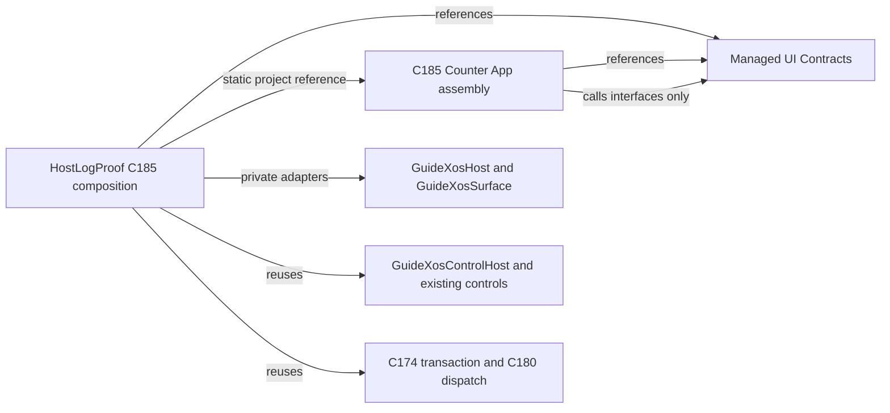

# NativeAOT C185 Managed Host-Service Boundary

## Result

C185 is **Outcome A — Accepted** for an isolated authoring and static-composition
slice. A separately built C# counter application uses public managed contracts
implemented by private adapters over the existing host, rendering surface,
control router, C174 resize transaction, C180 opt-in, and C181 lifetime pool.
The application is statically registered only in the C185 build profile. The
five normal application descriptors and production selection path are
unchanged.

This demonstrates independent source assembly compilation and static
NativeAOT composition. It does not provide runtime loading of managed DLLs or a
production guest selector for the sample.

## Preflight and C183/C184 findings

- Repository: `D:\dev\guideXOSServerV1.1_DOTNET_SUPPORT`.
- Branch: `v1.1_DOTNET_SUPPORT`.
- Starting HEAD: `8c3a7010e49819202738396d568673c0273fbe88`.
- The C184 reports and source dependency graph were reviewed. C184 Gate A
  found that the 144-file HostLogProof compile set contains host services,
  rendering, native ABI, control routing, and internal resize dependencies;
  simply moving that source set would not create a coherent framework
  assembly. C183's public-surface probe also showed that the old internal
  C174 resize types could not be used by an independently compiled app.
- The requested protected ramdisk hash was verified:
  `AABE4E849B4FB7E4C47E0CA0D573C753879DB8612449DA39E848964E7A726FD8`.
  It was not staged or committed. The three pre-existing untracked protected
  directories remain in the worktree.
- No `.phase` marker was present. The source HEAD matched the prompt's expected
  revision and the C184 report, so no stale-prompt conflict was detected.
- QAC's CLI, coordinator, and GUI were active, with QEMU PID 28116 owned by
  the QAC CLI. No QAC or QEMU process was started, stopped, or modified.
- Available D: space was approximately 12.4 GiB before isolated builds.

## Architecture Gate A

| Option | Dependency and ownership effect | Complexity and risk | Decision |
|---|---|---|---|
| Contracts plus host adapters | External applications reference only a small contracts assembly. HostLogProof references the contracts and the independently built C185 application, then implements contracts using existing host services. Native resources remain host-owned. | No ABI or production registry change; no dependency cycle; resize and rendering remain on existing paths. Adapters add a bounded translation layer. | **Selected. Smallest practical separation.** |
| Extract a narrow framework core | Move a subset of application, window, surface, controls, input, and resize code into another project while leaving native-dependent implementations in HostLogProof. | The C184 graph showed that these responsibilities cross the same host-dependent types. Moving a coherent set requires extracting lifecycle, rendering, controls, input, and C174/C180 bridges together, increasing migration scope and risking a circular project graph and hot-path changes. | Deferred until there is a stable contracts and ownership boundary. |

The compile-time dependency direction has no cycle: `CounterApp` references
`Contracts`; the host references both. `Contracts` has no HostLogProof
reference. The app receives adapters during initialization and does not see
native ABI structures or callback tables.

## Public boundary and ownership

The public API is in `GuideXos.ManagedUi.Contracts`:

- `IManagedUiApplicationFactory` and `IManagedUiApplication` define static
  factory creation, initialization results, rendering, action/input dispatch,
  default-deny resize opt-in, resize completion, and teardown.
- `IManagedUiHostServices`, `IManagedUiWindow`, and `IManagedUiSurface`
  provide window creation, stable window identity and geometry, bounded
  drawing, clipping, redraw, input routing, activation requests, and closure.
- `IManagedUiLabel` and `IManagedUiButton` expose the existing controls behind
  bounded methods.
- Value types carry application/window generation identity, input events,
  resize bounds/proposals/results, and explicit `ManagedUiResult` failures.
- The API contains no unmanaged pointer, native ABI layout, or callback-table
  type. It uses UTF-8 byte spans for labels and drawing text.

| Resource or responsibility | Allocate | Own | Invoke or mutate | Release |
|---|---|---|---|---|
| Native window surface and compositor backing | Native host through `GuideXosHost` | Native host | Host callbacks; adapters call existing `GuideXosSurface` methods | Host closes surface; adapter close is idempotent and never frees native storage directly |
| Managed window, surface, label, and button wrappers | C185 host adapter during app initialization | Adapter for one application generation | External app calls contract; adapter validates bounds and forwards to existing surface/control implementations | App `OnTearingDown`; host adapter releases controls and closes its surface |
| Control routing and focus state | Existing `GuideXosControlHost` | Existing host/control path | Adapter maps pointer and key events to the existing router | Reset on window close or application teardown |
| Counter and layout/rollback state | `CounterApplication` | External application instance | Its input/action and resize methods | `OnTearingDown` resets state after closing the window |
| Application slot and generation | Existing C181 `GuideXosManagedApplicationLifetime` | Host lifetime pool, with five-slot capacity | Static C185 runtime uses generation-checked lookup and dispatch | Lifetime clear invokes deterministic teardown; stale generations are rejected |

The initial adapter deliberately accepts one label and one button per window.
It reuses `GuideXosLabel`, `GuideXosButton`, `GuideXosControlHost`, and the
existing drawing surface instead of adding another widget or rendering
framework. Surface rectangles and text are checked against current window
bounds. Redraw dispatch is synchronous so host-backed surface callbacks stay
within their valid context.

The native host currently has no programmatic activation callback. The public
`RequestActivation` method therefore returns `Unsupported`; normal input still
uses the existing active-window dispatch and shared control focus router.

## First external UI slice

`GuideXos.C185.CounterApp` independently compiles against only the contracts
project. Its counter window creates a text label and an “Add one” button. The
app owns its count, renders through the contract surface and existing controls,
handles pointer activation and keyboard activation routed through the shared
control host, and requests redraw after each state change. Initialization
reports failures and rolls back partial setup through deterministic teardown.

The app opts into resize bounds of 320×180 through 720×480. C180 continues to
deny resize for apps that do not opt in. For this app, the host maps the public
bounds/proposal to the existing C174 geometry candidate and transaction. The
app stages its layout, reports the rendered state, and restores its prior
layout if the shared transaction rejects the candidate. The window identity
stays fixed as application ID, generation, and ordinal 1.

## Static factory and lifecycle

The isolated `GuideXosManagedHostServicesC185Composition` owns a one-entry
static factory table for application ID `0xC1850001`. Its descriptor directly
constructs the private host bridge around `CounterApplicationFactory.Create`.
The C185-only `ManagedMain` branch dispatches through this composition and the
existing C181 five-slot lifetime pool. No reflection, source inclusion of the
external app, dynamic DLL load, production application descriptor, native
selector, or packaging change is used.

Initialization errors release any partially created window/control resources.
The application and window teardown paths are idempotent. Generation-checked
runtime lookup prevents a callback from reaching a reused slot through an old
generation. The app factory is statically reachable from the C185 composition
root, and the C185 branch is absent from a default HostLogProof build.

## Hosted verification

The C185 runner invokes the actual `GuideXosHost`, surface, control, lifetime,
and resize implementation with test-controlled native ABI callbacks. The
callbacks stand in for the native edge; the contract adapters and managed host
services under test are the real implementation.

| Verification | Result |
|---|---|
| C185 focused cases | 28 passed; first failed case 0 |
| Service/application operations | 1,000 |
| Resize transactions | 500; 0 resize-path allocated bytes |
| Rejected requests | 250 |
| Failure and recovery operations | 250 |
| Complete application lifecycles | 100 |
| Service-operation allocation | 0 bytes |
| Native callback exercise | 4 text draws, 2 rectangle draws, 1 window create, 1 window close |
| Existing C182 starter | 15 checks passed; 100 resize transactions; 0 resize-path allocated bytes |
| Existing managed UI regression | 38 suites passed, 0 failed, 930 cases passed |
| Settings host regression | C167 20 cases and C168 31 cases passed |

The C180-era wrapper `scripts/dotnet/run-managed-ui-regressions.ps1` exited
with status 1 because its acceptance manifest still requires 36 suites / 899
cases and its expected suite list omits the two C181 residency suites. Its
three executed steps all passed: C135 host compilation, the direct managed UI
runner (38/930), and C167/C168 Settings checks. The direct host-runner summary
was `MANAGED-UI-HOST-GATE suites=38 passed=38 failed=0 cases=930 result=PASS`.
This wrapper assertion mismatch is recorded rather than represented as a
passing aggregate manifest.

## NativeAOT and ELF evidence

The C185 profile was published with NativeAOT using the repository's
`runtime_support.c` freestanding object, the Visual C++ environment, and
`IlcUseEnvironmentalTools=true`. The build log shows separate build outputs
for `GuideXos.ManagedUi.Contracts.dll` and
`GuideXos.C185.CounterApp.dll` before HostLogProof native code generation.
The CounterApp project references Contracts, and HostLogProof references both
assemblies as projects; CounterApp source is not included in HostLogProof's
compile items.

The PE link map retains these application methods in the NativeAOT image:

| Retained method | PE virtual address |
|---|---:|
| `CounterApplicationFactory.Create` | `0x100019C0` |
| `CounterApplication..ctor` | `0x100019F0` |
| `CounterApplication.HandleAction` | `0x10001C30` |
| `CounterApplication.HandleInput` | `0x10001E00` |
| `CounterApplication.HandleResize` | `0x10001EA0` |
| `CounterApplication.OnTearingDown` | `0x10001FF0` |
| `ManagedMain` / static composition entry | `0x100081F0` |

The retained constructors and handlers are also called through the static
composition and the hosted lifetime/interaction/resize/teardown paths. The
hosted tests exercise those paths; the NativeAOT executable itself is not
invoked as a Windows process because it is a native-subsystem image for the
kernel PE-to-ELF path.

`tools/dotnet/pe_to_elf_v2_fixed_base.py` converted the 647,680-byte PE to a
667,648-byte ELF64 AMD64 executable. `readelf -h` confirmed ELF64, little
endian, executable type, AMD64 machine, and entry `0x100082B0`; `readelf -l`
reported seven loadable program headers with the fixed `0x10000000` image
base. The ELF has no section-header table, as expected from this converter's
load-segment format. No guest boot was run: this is an isolated sample with no
production registration, and guest qualification is optional for that scope.

The AOT build emitted no C185 application or adapter compiler errors. Warnings
were:

- Existing `CA2014` stack allocation warning in
  `Applications/ManagedNotes.cs:322`.
- Existing project warning that the explicit `Microsoft.DotNet.ILCompiler`
  package reference should be removed to avoid versioning problems.
- Linker warnings from the established native-subsystem image configuration:
  `LNK4237` for `advapi32`/`kernel32` imports with `/SUBSYSTEM:NATIVE`,
  `LNK4281` for the required fixed `0x10000000` base, and `LNK4210` for `.CRT`
  sections in the workstation GC and C runtime libraries. The link completed;
  these are warnings, not unresolved C185 symbols or link failures.

## Compatibility and remaining limits

The default composition still uses the same five production applications and
descriptors. ABI v4 remains 128 bytes; callback offsets 104, 112, and 120 are
unchanged; production selectors remain 4–8; the C181 five-instance capacity,
C180 default-deny policy, and C174 transactions remain in the existing paths.
Settings persistence, File Explorer behavior, Notes editing/save behavior,
Calculator behavior, and Task Manager refresh behavior were not migrated or
altered. No kernel source, ABI, or production packaging file changed.

The demonstration supports one statically composed app, one window, one label,
one button, existing pointer/key routing, and the existing resize semantics.
It does not establish a general SDK, dynamic managed assembly loading,
hot-reload, arbitrary app installation, programmatic window activation, or a
standalone deployable app ELF.

## Artifacts

| Artifact | Size | SHA-256 |
|---|---:|---|
| `samples/managed/ManagedUiContracts/bin/x64/Release/net9.0/GuideXos.ManagedUi.Contracts.dll` | 10,752 B | `1F9F4F3D5087AC96C670F148ABC56F19AC2EFEC48ACCA1F89981154C71F94830` |
| `samples/managed/C185CounterApp/bin/x64/Release/net9.0/GuideXos.C185.CounterApp.dll` | 9,216 B | `836E5323F43514C9DEA23EF9781E8A45F54E8E4A6D8FE7B5B35C0535EF4E0814` |
| `out/dotnet/c185-managed-host-services/host-bin/x64/Release/net9.0/win-x64/publish/HostLogProof.exe` | 647,680 B | `7A70C1F8D6B9561220FEFE741D5AEA997A33B3EF0B7942A95C15505173EA033C` |
| `out/dotnet/c185-managed-host-services/HostLogProof.elf` | 667,648 B | `7D408CCC7ED260EDD172E8D729DAD7C138DE61C0326ABC72257A166FE620BB49` |
| `out/dotnet/c185-managed-host-services/HostLogProof.map` | 1,079,307 B | `2F2842B989E68EA981CFD470E8F8D49250FD75151F89E936D2BCEF9BA95F424E` |
| `out/dotnet/c185-managed-host-services/publish.log` | 2,602 B | `6806CF3B065601617427FDF5D4FC23D4EA420DD5E34543A3573F8DE6C4BCDF54` |
| `out/dotnet/c185-managed-host-services/counterapp-independent-build.log` | 700 B | `952EF98212B846FFD43CA20301BDD144843A1756578035A6F6C2028F383FE481` |
| `out/dotnet/c185-managed-host-services/c185-host-tests.log` | 278 B | `8FC537FC76922C292EC62E4E4C2F83FBB30A4C34F9FAF914F64CAD24985021F7` |
| `out/dotnet/c185-managed-host-services/c182-starter-tests.log` | 108 B | `993D51862059EAB8516DBE6A84556C4C61192105DBEC2604120A6289F2FFA8F4` |
| `out/dotnet/c185-managed-host-services/legacy-evidence/c135-focused-host-build.txt` | 1,448 B | `C63490D4047B799E126B60AC5602A6CC28935C277313A5A09FEBBCAEBEA8410F` |
| `out/dotnet/c185-managed-host-services/legacy-evidence/managed-ui-host-suites.txt` | 6,131 B | `E2F0947C031B721BC37D39F52C7B1744A395FBC22E867D249972ECE4C02BC08C` |
| `out/dotnet/c185-managed-host-services/legacy-evidence/c167-c168-settings-host-suites.txt` | 596 B | `A93E53E5929EC5F79AD71252BEDB519FA8DFD03DD40C3F5FFB9A5B3FEAAC4C72` |

The regression runner's subsidiary evidence is under
`out/dotnet/c185-managed-host-services/legacy-evidence/`. Published PE/ELF and
evidence outputs are isolated under `out/dotnet`. SDK `bin`/`obj` directories
remain untracked and are not committed; no generated PE/ELF or qualification
media is committed.

## Recommended C186 direction

Keep the contracts assembly as the only external dependency and first stabilize
its lifecycle, error, identity, activation, and surface-lifetime semantics.
Then move only host-neutral lifecycle or layout helpers whose dependency
closure can be proven independently. Preserve the host adapters and C174/C180
transaction path until a separate extraction has equivalent allocation,
identity, and rollback evidence. Do not add dynamic loading or production app
migration based on this single static integration proof.
