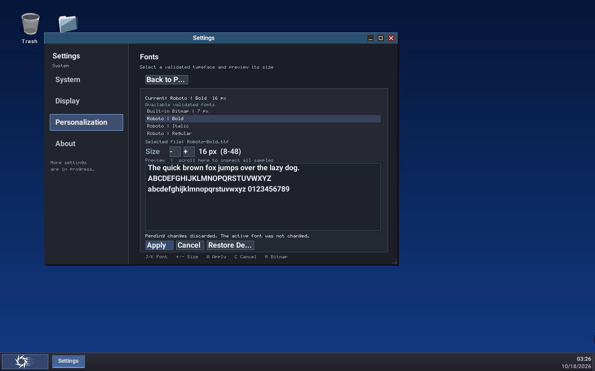
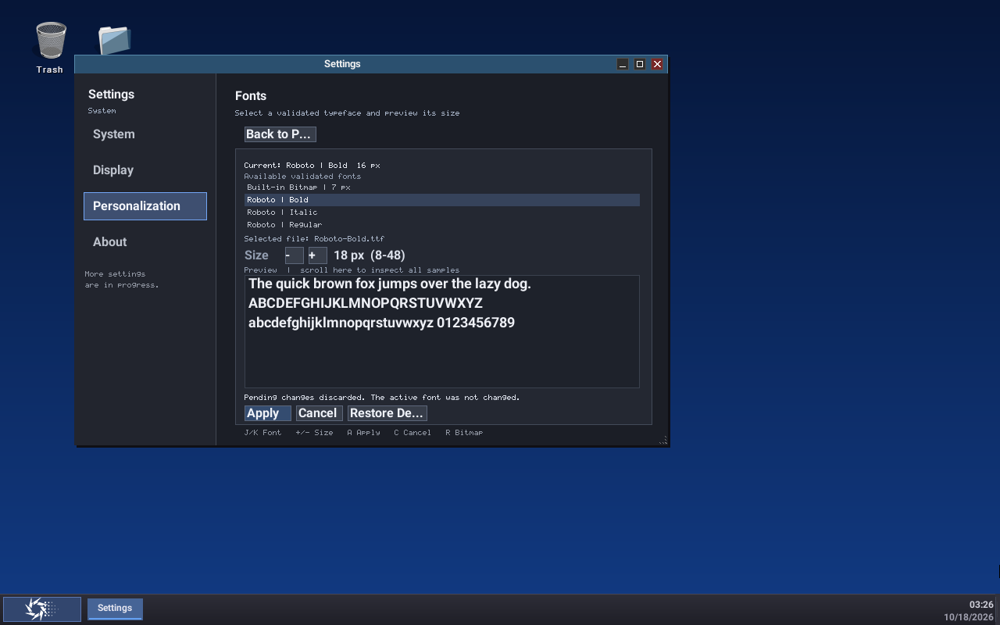
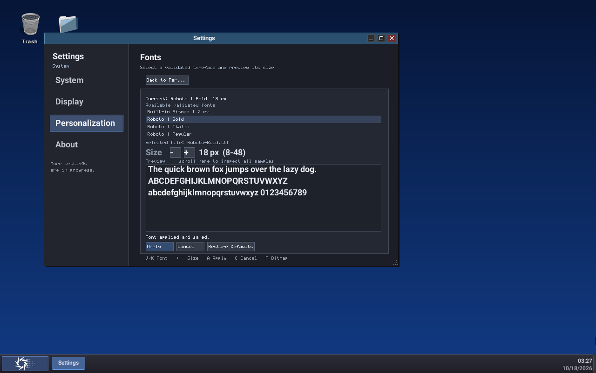
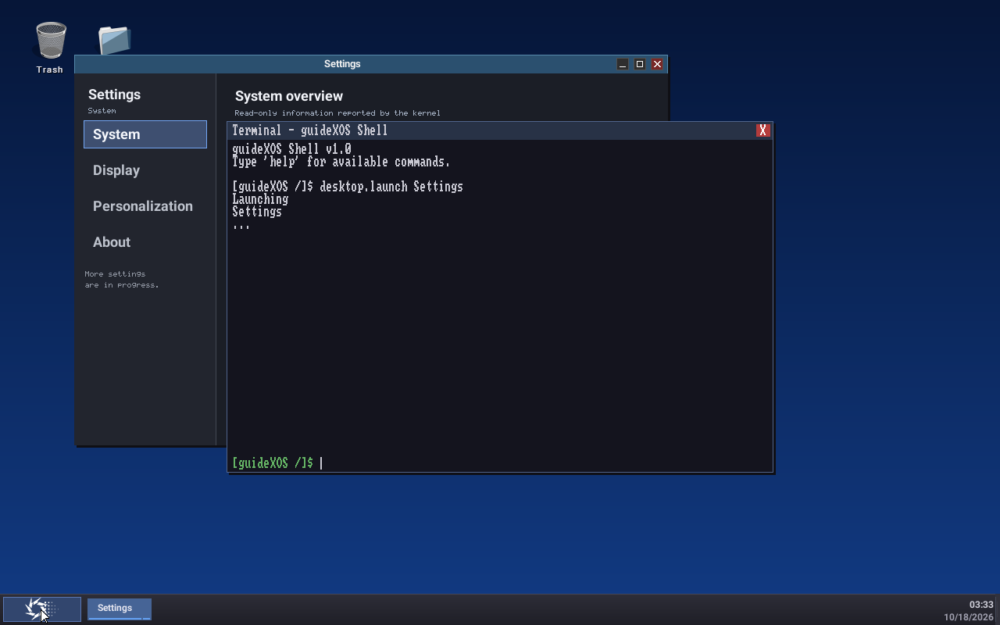
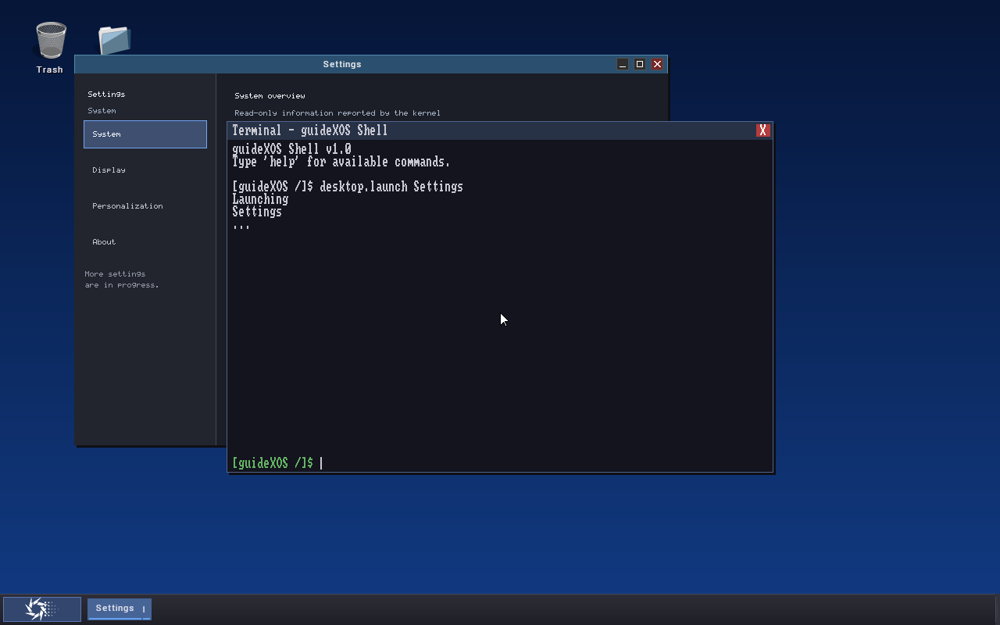

# FONT12R final v0.3 qualification results

**Disposition: Outcome B — conditionally qualified.** The native ABI and filesystem harness issues are resolved as stale test/runner configuration problems. The required live pointer focus and resize sequence did not complete, and the fresh-process boot did not produce a visible Fonts page readback. No font-specific correctness or stability defect was demonstrated. Do not advance phase status or begin FONT13.

## Repository and changes

The run started on branch FONT_SUPPORT at the requested HEAD 89a58151c19da3d6532d838ae3a29a2c0ab4711a. It remains on that branch and HEAD; no commit was created. The local branch was already one commit ahead of origin/FONT_SUPPORT at the start. Existing untracked files, all prior out/ content, and other QEMU projects were preserved.

The only tracked code changes are:

- [native_abi_layout_test.cpp](../../../tests/native_abi_layout_test.cpp): pin the appended App Model callback at offset 248 and the current AMD64 table size at 256 bytes.
- [run-native-filesystem-contract-test.ps1](../../../scripts/run-native-filesystem-contract-test.ps1): add the pinned TF-PSA built-in driver include directory, the Windows multimedia library, and Settings presentation core translation unit needed by this native harness.

No production font implementation file changed. These corrections remain uncommitted because the mandatory live desktop acceptance gates are open.

## Native regression dispositions

### ABI layout: stale assertion, no ABI incompatibility

The single public declaration is [sdk/include/guidexos/abi.h](../../../sdk/include/guidexos/abi.h#L95-L153). On AMD64, function pointer slots are 8 bytes: play_pcm remains at offset 240 and App Model get_document_activation_path was appended at offset 248, making sizeof(gx_host_calls) 256. The layout has no packing disagreement. Git history places the App Model append on October 2; the layout test's 248-byte size pin was last updated for the September 21 audio append.

The hosted runtime has its corresponding callback at offset 248 in [native_app_runtime.h](../../../native_app_runtime.h#L130-L180), and populates it in [native_app_runtime.cpp](../../../native_app_runtime.cpp#L1860-L1880). The bare-metal loader stores the SDK gx_host_calls type, zeroes sizeof(host), and reports sizeof(host) in its size field in [native_elf_baremetal.cpp](../../../kernel/core/native_elf_baremetal.cpp#L1958-L1961). Earlier slots stay at their pinned offsets; this is append-only ABI growth. The callback's availability on a particular host is separate from table layout.

The narrow assertion correction passes: [native ABI layout log](tests/native-abi-layout.log). There is no shipping binary incompatibility indicated by this discrepancy.

### Native filesystem harness: include and link configuration, no crypto source defect

The initial failure came from [TF-PSA-Crypto build_info.h](../../../third_party/mbedtls/tf-psa-crypto/include/tf-psa-crypto/build_info.h#L154) including crypto_adjust_config_enable_builtins.h without the pinned driver's include root on the harness command. That header is source-owned by the pinned TF-PSA-Crypto tree under drivers/builtin/include; it is not a generated output. The bootstrap's config-check and driver-wrapper generators do not produce this header. The repository bootstrap and profile verification passed with Mbed TLS 4.1.0 at 0fe989b6b514192783c469039edd325fd0989806 and TF-PSA-Crypto 1.1.0 at 29160dd877d29658279fd683b2ae57b320ddcf09; patch count was three. See [profile verification](tests/mbedtls-profile-bootstrap-verify.log).

After adding the include directory, the harness exposed two more omissions: -lwinmm for the native audio source and settings_presentation_core.cpp for Settings Center references. Adding these only to the test runner made the full filesystem contract runner build and pass. The initial diagnostic, intermediate link failure, and final complete pass are preserved as [baseline failure](tests/native-filesystem-contract-baseline-failure.log), [intermediate link failure](tests/native-filesystem-contract-intermediate-link-failure.log), and [final pass](tests/native-filesystem-contract-final.log). No placeholder header or cryptographic implementation change was used.

## Regression and forced build

The complete available focused FONT2–FONT11 suite passed 6,635 checks across eight runners: FONT2 contract 196, FONT3 parser 1,150, FONT4 raster 4,454, FONT5 cache 277, FONT6 selection 376, FONT8 layout 46, FONT10 typography 88, and FONT11 workload 48. There are no dedicated FONT7 or FONT9 standalone runners; their relevant Settings and preference behaviors are covered by the Settings presentation, selection, and storage tests. Per-run logs and summaries are under [tests](tests/).

Other requested regressions passed:

- Settings presentation core 2,651; native Settings runtime 828, including 100 lifecycle repetitions, 250 provider refresh cycles, and 1,000 transitions.
- Settings Center 89; Default Apps 39 model checks plus 9 interaction checks and 100 lifecycle cycles; Inventory 21 device plus 24 storage checks; S6 42; S7 21 accessibility plus 23 developer plus 14 navigation/search; Users 11 model plus 8 navigation plus 13 interaction/layout. All passed.
- Settings freestanding presentation validation, native present validation, compositor pointer-button validation, and compositor resize-notification validation passed.
- App Model actions 55, folder activation 26, default handlers 54, URI/protocol 41, explicit document activation 8 plus App Model file activation 60, and identity 25 all passed.
- Native ABI layout and native filesystem contract both pass after the narrow fixes above.

The forced command mingw32-make -B -C kernel ARCH=amd64 compiled and linked the freestanding kernel. ELF size is 2,813,880 bytes with SHA-256 9B8D1A86B5F2721F6A386FB40630ABA85F842239D72B050A3F0A855FE2A668F3. PE size is 2,937,438 bytes with SHA-256 7530DE7677014FFAED93B0813F882528789AD76D8C35454B98613B04F2A113CD. The PE Import, IAT, and Delay Import directories have zero size; no hosted imports were introduced. Full [build log](build/amd64-build.log), [PE inspection](build/kernel-pe-imports.txt), and [font BSS breakdown](build/kernel-font-bss.json) are included.

## Live guest evidence and open acceptance gates

All owned boots used private firmware and writable raw FAT32 images on PIIX IDE primary master, 1 GiB RAM, 2 vCPUs, 1280×800 VGA, disabled networking, loopback-only QMP/VNC, and standard PC PS/2 input. Boot1 was PID 32644 on QMP 59347/VNC 5949; fresh boot2 was PID 15976 on QMP 59348/VNC 5950; recovery boot3 was PID 27928 on QMP 59349/VNC 5951. Query-mice reported the QEMU PS/2 Mouse as current and relative; no USB tablet was added. Before boot2 and boot3, censuses found unrelated QEMU PIDs 34980 and 19792 from other projects; they were left untouched. Each FONT12R process was fresh, and each owned boot shut down through the guest shell with exitCode=0. The launch manifests, censuses, serial logs, image snapshots, traces, and helper scripts are in [guest evidence](guest/).

### Actual Apply and Cancel succeeded before reboot

On boot1, the desktop Start menu and Settings Personalization/Fonts route were reached through actual guest input. The serial log records mouse input for the Personalization and Fonts page events. The Fonts page showed current Roboto Bold 16 px. A pending size change was canceled; the page reported that the active font did not change. A later pending Bold 18 px selection was applied from the page, which then showed Current Roboto Bold 18 px and “Font applied and saved.” The post-Apply FAT inspection shows sequence 32, Roboto Bold 18 px, path /system/fonts/Roboto-Bold.ttf, fingerprint d3a00d5e4a8f1de7, identity 3d90e9fa85436469, checksum 9a1318df, and record SHA-256 9ad24a94cb8161e21d99db36b760d76fbc2a1a7ac60af7948759224d1e793d2c. Sequence 31 Roboto Bold 16 px remains in the other slot.

### Fresh-process visual restoration remains incomplete

Boot1 shut down cleanly. Boot2 launched a new QEMU process against the same private writable image; it did not use a system reset. Boot2 reached the desktop and launched Settings. The serial log confirms the app launch and focus acquisition. The captured Settings window is on System overview and covered by the foreground terminal; the Fonts Current line and actual shell font surfaces are not visible. Offline inspection confirms sequence 32 is still on disk, but the user-required visible restore proof is therefore incomplete. No post-restart comparison of titlebar, taskbar, Start Menu, and clock/date appearance was made.

### Recovery boot completed; visible bitmap confirmation remains incomplete

Boot3 used a disposable clone of the Bold 18 image. Only /system/fonts/Roboto-Bold.ttf was removed. The sequence-32 preference record and its hash stayed intact; inspection confirms the selected source is absent and the preference still points to it. Boot3 mounted FAT32, initialized system font selection with status Ok, reached the main loop, and launched native Settings. It shut down cleanly without a retry loop or crash.

The selection initialization code first sets the built-in bitmap handle active, then leaves it active when the persisted external source is unavailable; initialization normalizes that NotFound outcome to Ok. The real boot is consistent with that fallback branch, and the existing FONT6 selection suite covers missing-source fallback. However, the Settings Fonts Current line was not exposed after recovery, so the guest's active bitmap choice was not visibly read back. Treat guest fallback as boot/code-path corroborated, not visually signed off.

### Pointer focus and resize did not qualify

The PS/2 mouse opened the Start menu and reached the Fonts card, but calibrated longer pointer movement did not reliably reach intended window targets. A loopback VNC absolute-pointer attempt also failed to produce a dependable action. After that bounded diagnostic, further mouse-coordinate attempts stopped as directed. The traces record the actual QMP/VNC input requests and query-mice result.

The screenshot and serial evidence do not establish two-window pointer focus changes, active-window identity changes, reliable titlebar/control hit testing, Start Menu and taskbar hit targets as a complete set, or a supported live resize. No before/after guest window dimensions were recorded. Therefore the required Task 5 focus/hit-testing and Task 6 resize gates remain open; passing compositor button/resize-notification and Settings lifecycle tests does not replace those real guest interactions.

## Memory and v0.3 disposition

Measured font-related AMD64 BSS is 1,143,728 bytes: raster scratch 238,880; loader source records 590,624; glyph cache 69,152; selection/discovery 244,736; remaining font state 336 bytes. The whole kernel BSS is about 580,180,576 bytes (553.30 MiB), dominated by non-font pools. A 1 GiB guest booted and exercised the path. The v0.3 minimum-RAM target is unspecified, so this establishes that the font budget did not prevent the tested guest boot, not that every target's total memory budget is accepted.

| Decision area | Qualification | v0.3 disposition |
|---|---|---|
| Font feature readiness | Focused tests, storage, Apply/Cancel, and forced build pass; no font-specific defect was found. Live UI acceptance is incomplete. | Conditional; keep Outcome B. |
| Integration readiness | The ABI and harness regression dispositions are complete. Full pointer focus, resize, visible restart restoration, and visual recovery readback remain open. | Do not record unconditional desktop integration signoff. A controlled integration can proceed only with these guest checks tracked for closure. |
| Combined release readiness | This branch has not been merged, and the integrated v0.3 release candidate has not been tested. | Not qualified. Require post-integration regressions and the live guest smoke before RC signoff. |

The remaining Outcome A gates are a reliable real guest sequence for two-window pointer focus and hit testing, supported live resize with dimensions/redraw evidence, visible Fonts Current restoration after a fresh-process reboot, and visible confirmation of bitmap fallback on the missing-source clone. There is no demonstrated font-specific correctness blocker, so Outcome C is not supported by the evidence.

## Evidence index

- [Native ABI layout pass](tests/native-abi-layout.log)
- [Mbed TLS profile verification](tests/mbedtls-profile-bootstrap-verify.log)
- [Native filesystem baseline failure](tests/native-filesystem-contract-baseline-failure.log), [intermediate runner failure](tests/native-filesystem-contract-intermediate-link-failure.log), and [final pass](tests/native-filesystem-contract-final.log)
- [Regression logs and summaries](tests/)
- [Forced build, PE import inspection, and BSS accounting](build/)
- [Guest logs, manifests, preference images, screenshots, and input traces](guest/)
