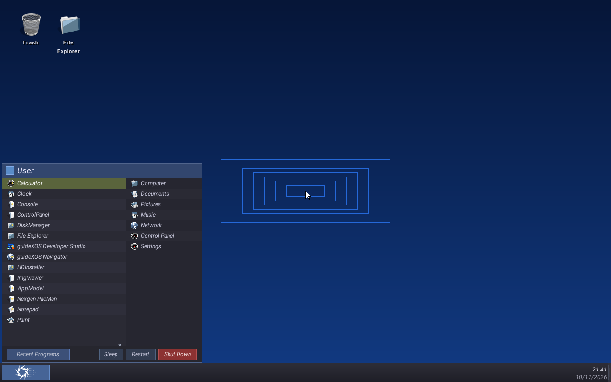
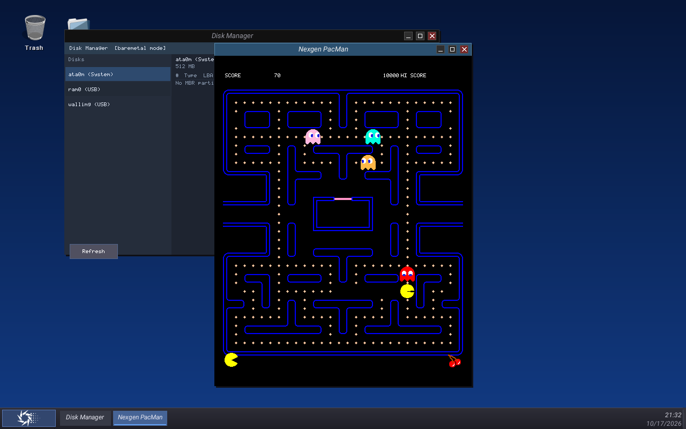
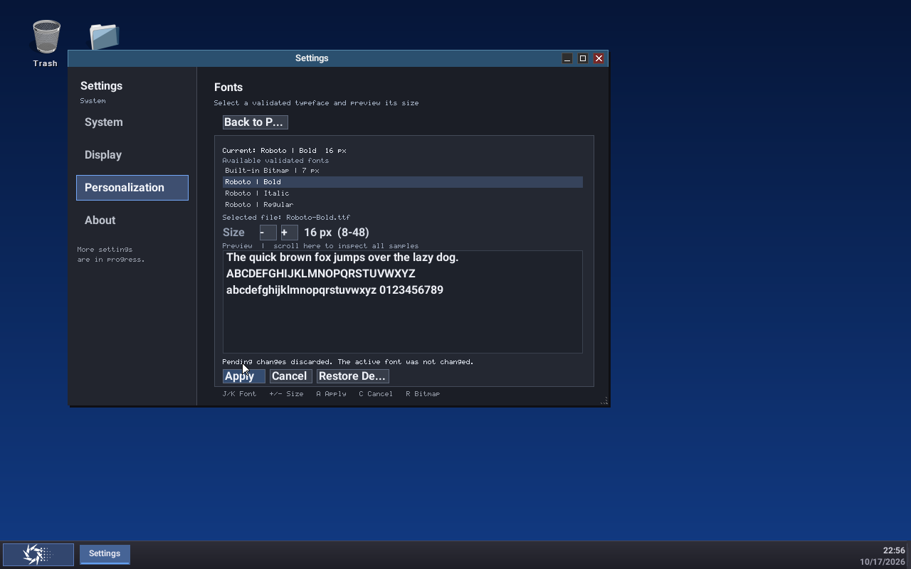
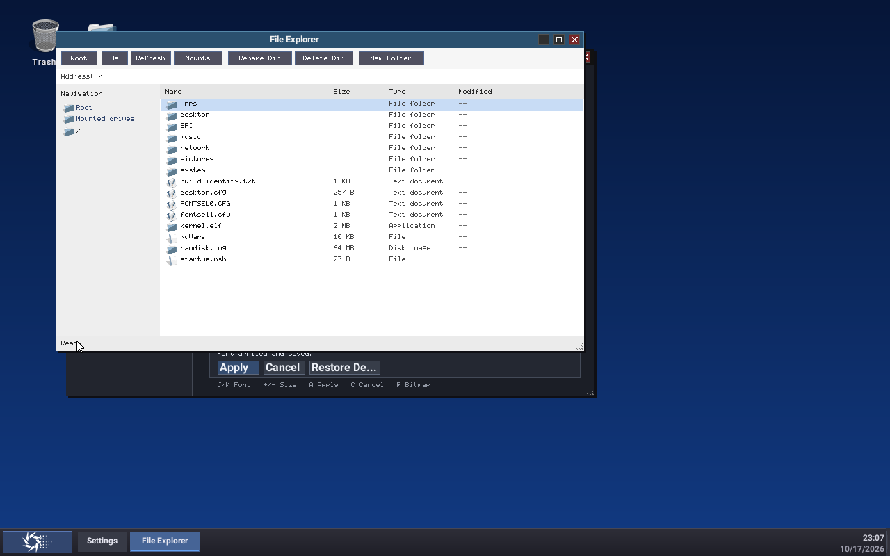
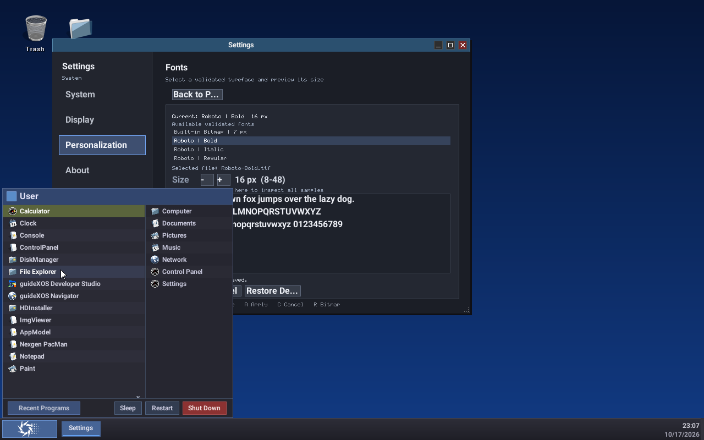
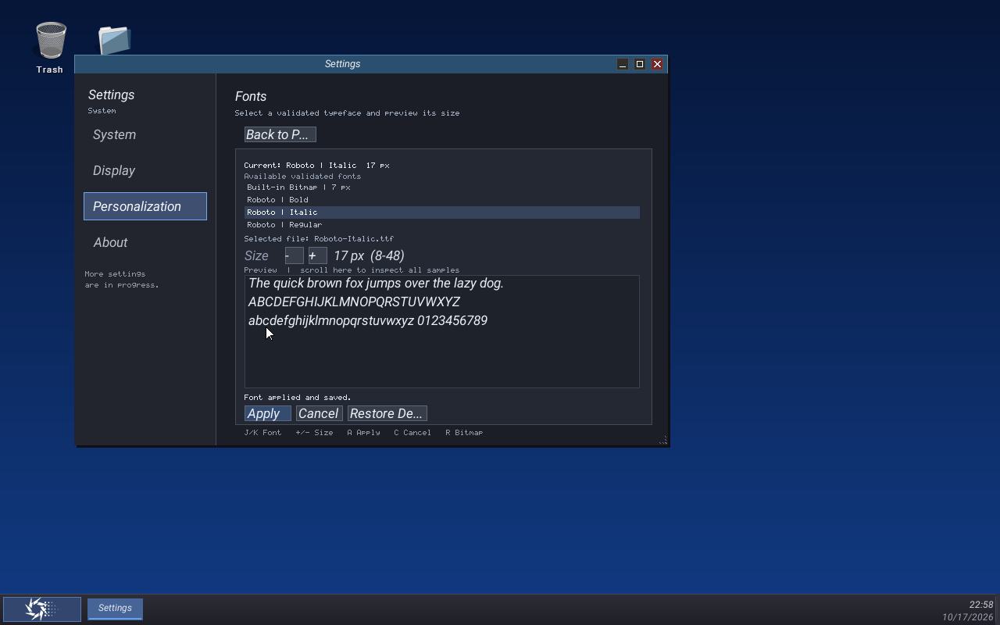
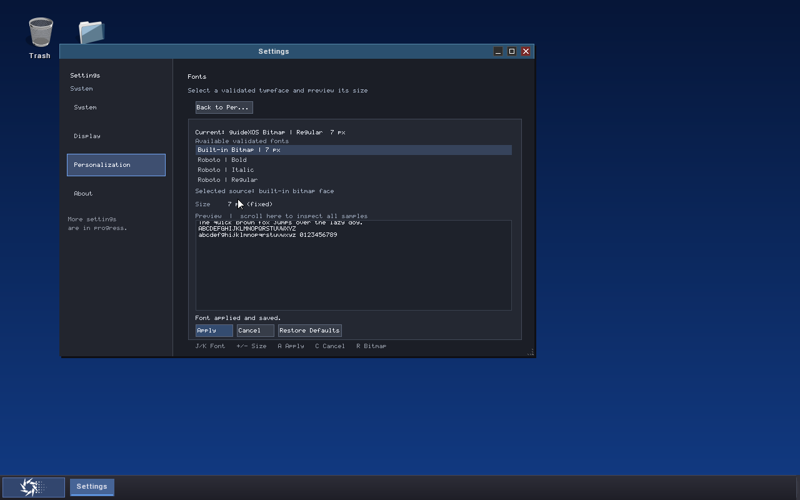
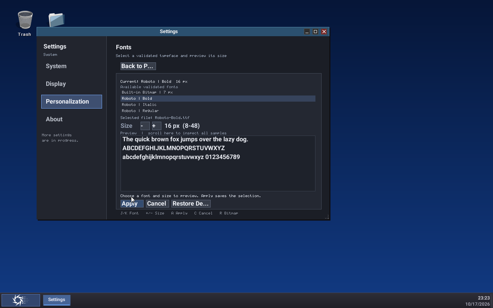

# guideXOS Server — FONT11: Glyph Cache Investigation & Shell Typography Polish

**Outcome: B — implementation and hosted/build gates pass; persistent guest font Apply remains unqualified.** No phase tracking was advanced and no commit was created.

## 1. Scope and starting state

FONT11 began on `FONT_SUPPORT` at `7dc22afca50519114693d908b09a56e22152dc59`, matching the requested starting HEAD. The branch was not changed. The worktree already contained untracked `out/` artifacts from earlier font phases; they were preserved. FONT5, FONT6, FONT8, FONT9 and FONT10 reports and their cache, selection, persistence, shell-layout and guest evidence were reviewed before implementation.

No FONT phase-tracking marker was found or changed. At closeout, HEAD is still the starting commit and this work remains uncommitted because the required guest-persistence gate is open. No other checkout or project's QEMU process was altered.

## 2. Cache root cause

The FONT10 report recorded 8,585 hits, 10,376 misses/rasterizations, 10,360 evictions, 797 resident coverage bytes and a 1,545-byte peak. These counters were easy to misread as a coverage-capacity problem. They were not.

FONT5 used 16 entries, each paired with a fixed 4,096-byte coverage slot: `s_pixels[16][4096]`. Together those slots reserved the full 65,536-byte coverage arena whether or not the glyph used it. `bytesUsed` and `peakBytesUsed` counted only each glyph's populated `width × height` coverage, not those reserved slots. Small 12–17 px shell glyphs therefore left most slot bytes unused while filling all 16 entry records. Once 16 records were live, every later cache miss evicted the least-recently-used record, even though the pixel arena had ample unused capacity.

The original counters show that threshold directly: 10,376 misses minus 10,360 evictions leaves 16 initial insertions. The cache remained at 16 entries. Final coverage occupancy was about 1.2% of the 65,536-byte arena; the peak was about 2.4%. Those low byte values reflected small glyph bitmaps, while eviction was driven by the entry limit.

| Investigation point | Finding |
|---|---|
| Cache key | Stable FontId, runtime slot, runtime slot generation, glyph ID, pixel size and raster configuration. Selection-generation is not part of the key. |
| Font/handle changes | A face/size change uses a different identity or size key. Unloading invalidates entries for that exact slot/generation; unrelated entries remain valid. Stale handles are rejected by the manager. |
| Invalidation frequency | No generation change or cache reset was needed between the captured unchanged redraws. Reset is explicit and also occurs during manager shutdown/reinitialization; counters do not reset per draw. |
| Whitespace/empty glyphs | Zero-area coverage still has useful advance metrics and may occupy an entry while using zero coverage bytes. It can contribute to entry pressure, but it is valid cache content. The cache unit test verifies the empty-space entry. |
| Rasterization on repeated draw | The FONT10 workload revisits many of the same glyph keys. With only 16 entries, LRU eviction made formerly seen glyphs miss again. The shared manager/cache path does not rasterize a resident key again. |
| Scratch and ownership | FONT4's raster scratch and FONT5's cache are shared. FONT2's manager lock serializes operations; there is no per-window cache or duplicated scratch. |
| Large glyph admission | A glyph above the 4,096-pixel cache-entry limit is rendered from bounded shared scratch without retention. FONT4 still caps raster dimensions at 128×128. The old counters did not distinguish this bypass from other misses; FONT11 adds separate bypass/failure counters. |
| Counter meaning | Hits, misses, rasterizations and evictions are saturating counters since reset. `bytesUsed` is current populated coverage; `peakBytesUsed` is its high-water mark since reset. Neither reports the static arrays' allocated size. |

Some cold misses are expected: new glyph IDs, a different face or pixel size, and newly displayed labels must be rasterized once. The defect demonstrated here was that a warm, unchanged redraw rasterized many already-seen glyphs because the metadata ceiling could not retain the working set.

## 3. Deterministic workload and before/after measurements

`tests/font11_glyph_cache_workload_test.cpp` replays the FONT10 shell labels through the same bounded text layout and grayscale drawing path, with the accepted Roboto Italic face. The 17 title/taskbar/Start Menu label surfaces use their effective 13 px title, 12 px taskbar/menu and 17 px profile sizes. The two clock lines are measured separately at 12 px using `19:08`, `10/17/2026`, then changed text. The harness reports hits, misses, raster attempts, evictions, entry count, resident/peak coverage, repeated glyph keys, fitted codepoints and cache classifications per surface and frame. It also records the handle generation.

The detailed surface table and repeated-key list are in [`../evidence/font11/cache-workload-results.md`](../evidence/font11/cache-workload-results.md). Like-for-like results for the original 17 surfaces:

| Measure | Before: 16 fixed entries | After: 72 variable-size entries |
|---|---:|---:|
| Fitted codepoints per frame | 181 | 181 |
| Unique glyph/size keys | 56 | 56 |
| Repeated key occurrences within the cold frame | 125 | 125 |
| Cold hits / misses / rasterizations | 88 / 93 / 93 | 125 / 56 / 56 |
| Cold evictions | 77 | 0 |
| Unchanged warm redraw additional misses / rasterizations | 93 / 93 | 0 / 0 |
| Warm redraw additional hits | 88 | 181 |
| Entries after the original label surfaces | 16 | 56 |
| Coverage bytes after the original label surfaces | 981 | 3,512 |

The old warm pass accumulated 186 misses/rasterizations and 170 evictions. With clock/date included, FONT11 records 65 unique entries and 4,038 resident/peak bytes. The cold clock/date pass added nine new keys and nine rasterizations; unchanged time/date and a minute/date change added hits only. The harness ended with 342 hits, 65 misses/rasterizations and zero evictions. No oversized/admission bypass, raster failure, coverage eviction or compaction occurred in this representative workload. The selected runtime handle remained generation 1 throughout.

This is a raster-work measurement, not an elapsed frame-time benchmark. No wall-clock speedup is claimed. It establishes that an unchanged warm redraw performs zero additional rasterizations for the retained workload.

## 4. Cache correction and memory evidence

The fixed cache now has 72 metadata entries backed by a variable-size, first-fit coverage arena. It uses bounded deterministic compaction when holes prevent admission, and LRU eviction with stable lower-index tie-breaking when entry or coverage limits are reached. Entry-capacity and coverage-capacity evictions, oversized and admission bypasses, raster failures and compactions are counted separately. Zero-area glyph metrics remain cacheable without consuming coverage bytes.

The coverage cap remains 65,536 bytes and the per-glyph cache limit remains 4,096 pixels. Metadata remains under its existing 4,096-byte allowance. Total static cache storage reports 69,128 bytes, below the existing 72 KiB maximum; the change adds no heap allocation. FONT4's existing shared raster scratch remains shared and unchanged. Large glyph fallback continues to draw from scratch without cache admission.

The hosted cache regression stresses warm reuse, entry-capacity eviction, coverage-capacity eviction, fragmented coverage and compaction, oversize bypass, failed rasterization, font identity and runtime generations, stale handles, invalidation and counter reset. Its final results are in `out/font11-validation/font-cache-final.log` and `font-cache.log`.

## 5. Native shell typography audit

| Surface | FONT11 decision |
|---|---|
| Horizontal taskbar clock/date | Migrated through the FONT6-selected shell renderer at an effective maximum of 12 px. Existing right-side clock reservation remains 70 px. |
| Vertical taskbar clock/date | Retains bitmap text. The dock's 40 px column cannot fit the complete date at the horizontal clock's size without changing date format or layout. |
| Window titles/decorations | FONT10's centered, bounded title role and control reserve remain. Hosted checks cover narrow/long titles, negative bearings and active/inactive colors. No further safe alignment change was needed. |
| Taskbar application labels | FONT10's bounded label role remains inside existing button geometry. Long labels are ellipsized inside each button. |
| Start Menu labels/navigation/status | FONT10's existing bounded renderer and fixed row/hit geometry remain. The cache investigation confirms repeated menu labels now warm correctly. No additional spacing change was warranted. |
| Desktop icon captions | Remain bitmap text. Their fixed multi-line buffers and label clipping are coupled to icon-grid spacing, drag selection and rename hit ownership. Recommend a separate icon-layout and interaction audit before any migration. |
| Boot, panic, recovery, diagnostics and Console | Intentional bitmap paths remain unchanged. Application-body rendering remains out of scope. |

The clock helper reserves a bounded inner rectangle, right-aligns each line and rejects invalid or undersized geometry. At the normal 70×48 horizontal widget it reserves 66×16 px lines at y offsets 6 and 22. Full `MM/DD/YYYY` fits at 12 px in the 66 px text span. The taskbar layout reserves the clock area before drawing application buttons, with a gap between the button limit and clock. Clock strings are formatted by the existing time/date code, so digits and punctuation do not change. Existing clock-triggered taskbar redraws repaint the same stable rectangle; font selection continues to request the regular desktop redraw. When scalable rendering is unavailable, the shell helper uses the bounded bitmap fit path.

The tests cover the 12 px role cap, independent expected layout positions, full date fit, right alignment, minimum accepted widget bounds, rejected undersized/overflowing bounds, a long taskbar label, long title clipping and negative-bearing placement. The guest screenshots show the clock/date and menu in the integrated desktop.

## 6. Regression results

The complete logs are preserved in `out/font11-validation/`. FONT2–FONT10 font/rendering regressions and relevant Settings/native presentation suites passed:

| Suite | Result |
|---|---:|
| FONT2 shared font contract | 196 checks, 0 failures |
| FONT3 TrueType loading and validation | 1,150 checks, 0 failures |
| FONT4 TrueType rasterization | 4,454 checks, 0 failures |
| FONT5 cache and grayscale renderer | 277 checks, 0 failures |
| FONT6 font selection, persistence and fallback | 376 checks, 0 failures |
| FONT8 text layout | 46 checks, 0 failures |
| FONT10 shell typography, including FONT11 clock geometry | 88 checks, 0 failures |
| FONT11 deterministic cache workload | 48 checks, 0 failures |
| Settings presentation core | 2,651/2,651 |
| Settings Center | 89/89 |
| Settings S6 | 42/42 |
| Settings S7 accessibility/developer/navigation | 58/58 |
| Settings Users model/navigation/layout | 32/32 |
| Settings device/storage inventory | 45/45 |
| Default Apps model and interaction | 39 + 9 checks; 100 lifecycle cycles, 0 failures |
| Native Settings runtime | 828/828; 100 lifecycle repetitions, 250 provider refresh cycles and 1,000 notification/state transitions |
| Native presentation validation | PASS |
| Settings freestanding compile, bounded link and unresolved-symbol checks | PASS |

The cache suite verifies fixed capacities, warm-cache reuse, deterministic entry and coverage eviction classification, compaction, oversized uncached drawing, misses after generation/identity changes, stale handles, fallback, and reset behavior. The shell suite uses independent expected coordinates and guarded framebuffer canaries; it checks the right-aligned clock, a full date at 66 px, the 38 px minimum clock height, rejected narrow/short/overflowing bounds, long taskbar text, negative bearings, missing-glyph/invalid-UTF-8 fallback, and a clock redraw after a generation change. FONT6 selection tests cover 8 px/48 px UI boundaries, stale runtime handles, repeated switches and persistence failures. The persistence suite exercises 24 successive Apply operations; the guest separately exercised Cancel twice. Existing Settings/native runtime regressions retain their window identity/focus and lifecycle checks, including duplicate launch focusing the existing Settings instance. The guest could not qualify those properties across a successful FONT Apply because the storage call stalled.

In the guest, Cancel was exercised repeatedly and restored the active persisted Roboto Italic 17 px choice after pending font previews. The actual Settings Apply operation did not complete; therefore repeated successful Settings Apply/Cancel UI cycles and post-Apply focus/window identity are not claimed as qualified in this phase.

The separate existing native ABI layout discrepancy remains unrelated: `tests/native_abi_layout_test.cpp` expects `sizeof(gx_host_calls) == 248`, while the current MinGW result is 256 (`out/font10-validation/native_abi_layout_test.log`). No ABI change was made to alter that result.

## 7. AMD64 freestanding qualification

Both the ordinary forced AMD64 build and the proof-instrumented full kernel build compiled and linked the modified production files with the actual freestanding kernel flags. The proof build was forced with `mingw32-make ARCH=amd64 -B EXTRA_CFLAGS=-DGXOS_FONT11_QEMU_PROOF`; it completed with `Built: build/amd64/bin/kernel.elf` in `out/font11-validation/amd64-qemu-proof-build-finalpass.log`. The ordinary full build log is `out/font11-validation/amd64-build.log`.

The build uses `-ffreestanding -fno-exceptions -fno-rtti -nostdlib -nostdinc++ -fno-builtin`; the kernel PE import directory has no entries. No STL, exceptions, RTTI, heap allocation or hosted runtime dependency was added to production code. The full forced compile/link passed. Existing unrelated warning output is recorded in the build logs.

## 8. Isolated QEMU desktop proof

Fresh process-ownership censuses were saved before the isolated launches. Each guest used private OVMF firmware, private raw FAT32 media, serial output and QMP/GDB endpoints. No VVFAT overwrite behavior was used. During the final census, two QEMU processes belonging to other projects were present and left untouched; all FONT11 processes were stopped through their own private QMP endpoints. The raw process evidence is in `out/font11-validation/qemu-boot2-prelaunch-census.json`, `qemu-boot3-prelaunch-census.json` and `qemu-final-ownership-census.json`.

The successful raw PIIX/IDE guest booted the desktop with the persisted Roboto Italic 17 px preference. It opened the Start Menu, Settings Fonts, Disk Manager and PacMan. A cold Start Menu draw recorded 48 misses/rasterizations and zero evictions. The next unchanged draw added hits and no misses, rasterizations or evictions. As more surfaces were opened, the combined Settings workload reached the 72-entry bound and produced deterministic entry-capacity evictions (three on the first new Settings surface, with no coverage eviction); unchanged subsequent redraws then hit. This is expected bounded-cache behavior for a working set larger than 72 entries, distinct from cold/warm churn in the 56-key reproducible surface set.

Later Settings/font-preview interactions introduced additional keys: by draw 22 the guest had 93 misses/rasterizations, 21 cumulative entry evictions, 5,810 resident/peak bytes and zero coverage evictions. Stable redraws between newly introduced surfaces left the rasterization count unchanged. The hosted workload records runtime handle generation 1 for its entire unchanged sequence; the guest proof instrumentation recorded cache counters, but a successful active-font Apply was not reached to qualify a live generation transition.

Representative screenshots:

The last two screenshots show a preview only: Current remains Roboto Italic 17 px while Regular 16 px is selected, including after the attempted Apply stalls. Applying starts the `/fontsel.tmp` persistence path, then stalls in `ata_pio_read`/`arch::amd64::inw` during ATA PIO storage access. This was reproduced twice on independent raw FAT32 guest images. The desktop continued receiving PIT heartbeats, but the preference write did not finish. A virtio-blk alternative confirmed that this kernel's virtio block detector is a stub and the root filesystem was unavailable. An isolated Q35/NVMe attempt also failed qualification: the guest firmware enumerated the NVMe device, then the kernel page-faulted while accessing BAR0 at physical `0x800000000` (8 GiB), which is outside the mapped address range. The ATA source confirms AHCI support is not implemented yet. These guests were stopped through their own private QMP endpoints; no storage driver change was made as part of FONT11.

Thus this guest proves desktop rendering, clock/date alignment, cold/warm cache behavior, multiple-window presentation, and Cancel restoration. It does **not** prove a successful font Apply, bitmap-to-TrueType transition, persistence across restart after that Apply, or restored post-switch rendering. Those are required acceptance gates and are why the result is B.

## 9. Evidence index

- Hosted per-surface before/after cache data: [`../evidence/font11/cache-workload-results.md`](../evidence/font11/cache-workload-results.md).
- Test harness: [`../../tests/font11_glyph_cache_workload_test.cpp`](../../tests/font11_glyph_cache_workload_test.cpp).
- Shell geometry and fallback regression: [`../../tests/font10_shell_typography_test.cpp`](../../tests/font10_shell_typography_test.cpp).
- Cache stress regression: [`../../tests/font_glyph_cache_test.cpp`](../../tests/font_glyph_cache_test.cpp).
- Latest shell test log: `out/font11-validation/font10-shell-regression-final.log`.
- Raw test/build/QEMU logs, launch manifests, FAT32 images, firmware copies and process censuses: untracked artifacts under `out/font11-validation/`, preserved in the worktree.
- NVMe probe: `out/font11-validation/qemu-nvme-prelaunch-census.json`, `qemu-nvme-launch.json` and `guest-nvme.serial.log`; final ownership census: `qemu-final-ownership-census.json`.
- Screenshot index: [`../evidence/font11/README.md`](../evidence/font11/README.md).

## 10. Remaining limitations

1. The guest storage path stalls during ATA PIO reads before a font preference can be committed. Apply, persistent restart and post-switch rendering remain unqualified.
2. No qualified alternate writable guest path was available: virtio block is a detector stub, AHCI is not implemented, and the NVMe probe faults on its BAR mapping.
3. The vertical taskbar retains bitmap clock/date because its narrow dock cannot show the full date in the bounded horizontal-clock layout.
4. A desktop working set exceeding 72 distinct resident glyph keys can still evict by design. The cache remains bounded and subsequent stable redraws reuse whatever keys remain resident.
5. No elapsed frame-time benchmark was taken; only deterministic raster/cache work was measured.
6. Desktop icon caption migration needs its own layout/interaction audit. Application bodies, shaping, hinting and early-boot/diagnostic text remain out of scope.
7. The unrelated native ABI assertion discrepancy is still open and separate from this font qualification.

## 11. FONT12 recommendations and v0.3 readiness

Before FONT12, fix or independently qualify the ATA PIO persistence path used by Settings Apply. Then rerun an isolated real guest Apply for TrueType, Apply for bitmap, Apply for TrueType again, and fresh-process restore from the same writable raw image. Verify active/configured state, cache generation, clock/menu/title redraw, focus and window identity after every operation. Keep a workload over the 72-entry bound in the acceptance suite so classified entry eviction remains visible, while comparing identical cold and warm runs.

Treat desktop icon captions as a separate layout phase: first map line count, icon-grid spacing, text clipping, rename/selection states and mouse hit regions; only then test whether the FONT6 renderer can fit safely. Do not make broad application-body, shaping or hinting changes as part of that audit.

**v0.3 readiness: not ready for FONT11 acceptance or phase advance.** Hosted tests and the full AMD64 freestanding build pass, and the cache defect is corrected. Persistent guest font Apply and restore proof are still required before the v0.3 font/shell qualification can be called complete.

## 12. Closeout

FONT11 stops here at **Outcome B**. The branch remains `FONT_SUPPORT`; starting and ending HEAD are both `7dc22afca50519114693d908b09a56e22152dc59`. The worktree is dirty with the implementation, tests, report and evidence described above. No commit was made, no push occurred, and no FONT12 work or phase tracking update was started.

## 13. FONT11R continuation — guest storage qualification and closeout

This append records the continuation from the historical Outcome B state above. The earlier Outcome B and its screenshots remain as the record of that run; the final FONT11R classification is stated at the end of this section.

### 13.1 Starting state and change inventory

The continuation started on `FONT_SUPPORT` at `7dc22afca50519114693d908b09a56e22152dc59`, with no staged changes. The uncommitted FONT11 implementation already present at entry modified `kernel/core/desktop.cpp`, `desktop_font.cpp`, `desktop_system_font.cpp`, `font_glyph_cache.cpp`, `font_glyph_cache_internal.h`, `include/kernel/desktop_font.h`, `include/kernel/font_contract.h`, `tests/font10_shell_typography_test.cpp`, and `tests/font_glyph_cache_test.cpp`. The untracked FONT11 workload harness/runner, report, evidence directory and all existing `out/` experiments were preserved.

The final bounded-safety review added a progress limit to coverage-pressure eviction: at most the fixed 72-entry bound is considered, and eviction stops if accounting makes no progress. If the requested coverage still cannot be admitted, the cache returns the successful raster through the existing scratch buffer and records an admission bypass. Normal workload counters and output are unchanged; the focused cache and workload tests were rerun after this guard.

For this continuation, bounded serial proof markers were added in `kernel/core/ata.cpp`, `kernel/core/kernel_apps.cpp`, `kernel/core/main.cpp`, and `kernel/core/system_font_selection.cpp`, behind `GXOS_FONT11_QEMU_PROOF`. They record one ATA timeout at most, Apply stages, and a bounded ordinary storage read/write probe. The native selection-service probe runs only for the expected sequence-27 fixture. The Settings error path now retains the actual active-state query status instead of replacing it with `NotInitialized`. No ATA, VFS or FAT driver behavior was changed, and no font/cache implementation was rewritten. The regular full build omits the proof markers.

### 13.2 Apply boundary and storage probe

The historical report records an Apply that appeared to stop in `ata_pio_read`/`arch::amd64::inw`. Its serial record does not have stage markers sufficient to tell which of the twelve Apply steps had completed immediately before that observation. That precise historical boundary cannot be reconstructed from the old log, so the earlier ATA symptom is not presented as a proven FONT11 regression.

The continuation tested the supported raw IDE path before using Settings. In the earlier continuation boots, boot1's preflight used an invalid FAT 8.3 filename and returned `VFS_ERR_INVALID`; it did not reach a sector write. Boot2 corrected the path and its 20-byte write/read/unlink probe passed, but the native Apply probe was skipped because its sequence gate did not match the persisted fixture. Boot3 used the observed sequence 27 and the native selection-service probe returned `Ok`. On boot3 and boot4, the bounded `/f11r-rw.tmp` probe wrote 20 bytes (`0x14`), read back the same 20 bytes, matched the payload, and unlinked the file successfully. Neither serial log contains the proof-only ATA timeout marker.

The actual Settings Apply trace completed the full path: request and active-state check; candidate preparation and source validation; active handle staging; 1 KiB preference serialization; scratch write and readback verification; inactive-slot write and readback verification; scratch cleanup; active selection publication; desktop notification; and successful UI completion. Each reported status was successful. This places the continuation's last completed boundary at step 12, Apply completion, with no timeout.

### 13.3 FONT9 storage comparison and failure classification

The accepted FONT9 launch uses QEMU 11.0.0, `pc,accel=whpx`, a raw 512 MiB FAT32 superfloppy on the PIIX IDE primary master (`if=ide,index=0`), private OVMF firmware, 1 GiB RAM, disabled networking, and a 512-byte sector / 8-sector cluster / 32-reserved-sector / two-FAT layout with root cluster 2. The volume contains `/EFI/BOOT/BOOTX64.EFI` and the guideXOS root tree; UEFI loads from that volume and the kernel's ATA/VFS path mounts the same FAT32 volume as root. The earlier FONT11 boot1/boot2 manifests show the same PC/WHPX and raw IDE topology: boot1 used FONT11-prepared media and boot2 used a private FONT9-image clone. Those launches used GTK display and a GDB endpoint; the continuation used VNC without GDB. The old FONT11 boot3 manifest used `virtio-blk-pci`; that unsupported detector-stub run is not evidence about ATA PIO. The continuation did not try VVFAT, virtio, AHCI or NVMe.

The qualification run used a fresh private copy of FONT9's known-good 512 MiB raw FAT32 image. The kernel was replaced in place while retaining its existing 689-cluster FAT chain, and the prior preference-slot hashes were unchanged by that preparation. QEMU used one storage configuration across the continuation: QEMU 11.0.0 `pc,accel=whpx`, raw primary IDE master, private read-only OVMF copy, 2 vCPUs, 1 GiB RAM, VGA std, private VNC/QMP/serial endpoints, UTC RTC, and no network. No `cache=` or `aio=` option was set. No concurrent process accessed the image; firmware boot, ATA initialization, FAT32 root mount, preference restoration and preflight I/O completed in that order before Settings was used.

Classification: **A — qualification media/setup issue, with the exact historical trigger unconfirmed.** The prior reported stall was not reproduced using the supported FONT9 raw block-image configuration, first with ordinary file I/O, then through the native preference service and the actual Settings UI. The real transaction and restart now complete. There is no evidence that the FONT11 cache/font changes caused an ATA fault, and no storage-driver change was justified. Because the old failure record lacked stage markers, the exact trigger for that earlier observation remains unknown.

### 13.4 Real Settings workflow and persistence

Boot3 reached the desktop, opened native Settings → Personalization → Fonts, and opened File Explorer while Settings remained open. The Start Menu was also opened with Settings visible. These screens show the taskbar date `10/17/2026` and a ticking clock. Previewing Roboto Italic did not change the active or stored choice. Cancel reported that pending changes were discarded and left the active Roboto Bold 16 px selection intact.

The actual UI then applied Roboto Italic at 17 px, applied Built-in Bitmap at 7 px, and applied Roboto Bold at 16 px again. The Fonts page showed the applied selection and size after each operation, and the bitmap preview remained usable. Across these size changes, the Settings titlebar, title text, Start Menu, taskbar clock/date and participating shell text stayed visible within their bounds without clipping or overlap. The final disk inspection after shutdown found sequence 31 TrueType Roboto Bold 16 px in `FONTSEL0.CFG`, sequence 30 Built-in Bitmap 7 px in `fontsel1.cfg`, valid checksums, and no `/fontsel.tmp`. The full preference record is preserved in `out/font11r-validation/continuation/preference-state-final.json`.

Boot3 was shut down from the guest UI; serial ended with `reason=system-shutdown exitCode=0`. A fresh QEMU process then booted from the same private persistent image. Its Settings Fonts page displayed the restored Roboto Bold 16 px selection, and ordinary storage I/O passed again. Boot4 was closed through its verified private QMP endpoint after the read-only restoration check; the first guest's clean shutdown remains the restart boundary.

### 13.5 Repeated cache and clock evidence

The FONT11 workload was rerun against the final source. Like-for-like 17-surface results remained: the old cache had 93 cold misses/rasterizations and 77 evictions; the corrected cache had 56 cold misses/rasterizations and zero evictions. An unchanged warm redraw added zero misses and zero rasterizations. The separate clock/date pass ended at 65 entries, 4,038 resident/peak coverage bytes, 342 hits, 65 total misses/rasterizations, zero evictions, zero bypasses and zero raster failures. The cache reserves a fixed 65,536-byte coverage arena; total static cache storage is 69,128 bytes within the 72 KiB limit. No heap allocation was added. The regression covers generation identity, invalidation, stale handles, bounded entry/coverage pressure and reset behavior. The guest counters are not treated as an equivalent benchmark because the guest did not run the same deterministic workload.

### 13.6 Regression and AMD64 build results

The rerun used the current continuation source in an isolated C: source copy; outputs are under `out/font11r-validation/continuation/regression/`.

| Suite | Result |
|---|---:|
| FONT2 shared bitmap/font contract | 196 checks, 0 failures |
| FONT3 TrueType loading | 1,150 checks, 0 failures |
| FONT4 rasterization | 4,454 checks, 0 failures |
| FONT5 glyph cache | 277 checks, 0 failures |
| FONT6 selection, preview, persistence and fallback | 376 checks, 0 failures |
| FONT8 text layout | 46 checks, 0 failures |
| FONT10 shell typography and clock geometry | 88 checks, 0 failures |
| FONT11 cold/warm workload | 48 checks, 0 failures |
| Settings presentation core | 2,651/2,651 |
| Settings Center / S6 / S7 | 89/89; 42/42; 58/58 |
| Settings Users / device-storage inventory | 32/32; 45/45 |
| Settings Default Apps | 39 model + 9 interaction checks; 100 lifecycle cycles |
| Native Settings runtime | 828/828; 100 lifecycle repetitions, 250 provider refreshes, 1,000 state/notification transitions |
| Settings freestanding presentation harness | compile, bounded link and unresolved-symbol checks PASS |

A final forced full build, `mingw32-make -B -C kernel ARCH=amd64`, compiled and linked the complete freestanding AMD64 kernel after the bounded cache guard. The resulting `kernel.elf` is 2,813,880 bytes and `kernel.pe` is 2,937,438 bytes. `objdump -p` reports zero-sized PE import, import-address-table and delay-import directories; no hosted runtime imports were introduced. The existing PE-to-ELF conversion's undefined symbol-table entries (including `mainCRTStartup`, `__dso_handle` and kernel names) remain a toolchain/output condition and are not PE imports. The separate native ABI assertion remains 248 expected versus 256 actual and was not changed. The final build and image copies are under `out/font11r-validation/continuation/final-guard/`.

After the eviction progress guard, the glyph-cache suite passed 277 checks and the FONT11 cold/warm workload passed 48 checks with the same cache measurements: 56 cold rasterizations, zero cold evictions and zero additional warm rasterizations. Their final logs are also preserved under `out/font11r-validation/continuation/final-guard/`.

### 13.7 Ownership, preserved evidence and final classification

The FONT11R process used unique OVMF copies, raw media, VNC displays, QMP ports, serial logs and ownership manifests. Boot4's prelaunch census records two unrelated project guests; neither was attached to or terminated. A fresh post-close census records no QEMU processes. Existing historical screenshots, logs, untracked `out/` experiments and FONT11 evidence were preserved. New guest serial logs, launch/census manifests, preference records, the accepted private disk image and regression/build logs are under `out/font11r-validation/continuation/`.

The report's earlier Outcome B remains as historical context. **Final FONT11R result: Outcome A — FONT11 accepted.** The cache and taskbar clock/date behavior remain qualified; the requested font regressions, Settings/presentation regressions and forced AMD64 build pass; real Settings Apply and bitmap fallback succeed; and the last applied TrueType choice restores in a fresh QEMU process. The historical ATA observation's exact trigger is still unconfirmed, but the full real guest acceptance path now passes on the supported FONT9 storage configuration. No FONT12 work or push was started.
