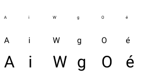

# FONT4 — Bounded TrueType Glyph Rasterization

**Status:** Outcome A — bounded outline decoding and grayscale rasterization accepted

FONT4 extends FONT3's owned TrueType source records with per-glyph lookup and rasterization. The system continues to use the built-in bitmap face as its default. This phase does not add system font selection, Settings controls, compositor migration, or a glyph cache.

## Repository and phase state

- Branch: `FONT_SUPPORT`.
- Starting commit: `30004b3509ca53d323123b3a53e00708e5f185d1`.
- Phase tracking uses the FONT1–FONT4 documents and `docs/evidence/`; no `.phase` marker exists at the repository root or under `docs/`.
- The pre-existing `out/font3-freetype-*` experiments were preserved and excluded from the FONT4 commit.
- The Roboto fixture, `assets/Fonts/roboto/OFL.txt`, and the existing `NOTICE.txt` provenance records were not changed.

## Architecture and API

The backend accepts the same single-face TrueType SFNT profile as FONT3. Each lookup or raster request revalidates the SFNT directory ranges needed for `head`, `maxp`, `cmap`, `hhea`, `hmtx`, `loca`, and `glyf`. Glyph-local `loca` offsets are checked for ordering and `glyf` bounds at point of use; successful file registration does not imply that every glyph record is valid.

The code point mapper prefers Unicode cmap format 12 and then format 4. It returns a glyph index, which is decoded to an internal outline, then converted into positioned metrics and optionally into coverage. These remain distinct stages; callers receive metrics or caller-owned pixels, never source pointers or partially decoded outlines. A missing scalar uses the font's `?` glyph while retaining the requested code point and reporting fallback.

`FontLookupGlyph` derives the same outline bounds, advance, and side bearing as `FontRasterizeGlyph`. Measurement and rasterization therefore use identical per-glyph advances and bearings. The common API is `FontRasterizeGlyph`, which writes 8-bit grayscale coverage into a caller-supplied buffer. Bitmap backend rasterization remains a conversion of the existing column-LSB glyph data.

TrueType registrations have `FontCapabilityRasterization` and `FontCapabilityNoDefaultSelection`. The latter protects the built-in default until a future selection phase. Existing runtime slot/generation validation applies before backend callbacks; the manager lock covers each callback and unload, so source bytes cannot be released while the callback is using them. Manager operations are task-context operations and are not interrupt-safe.

## Supported outline profile

Supported features:

- TrueType `glyf` outlines with simple glyph contours and composites.
- On-curve and off-curve points, implied on-curve midpoints, multiple contours, and quadratic Bézier segments.
- Simple-glyph repeat flags and signed/short coordinate delta decoding.
- Composite XY offsets and point-to-point attachment; uniform, separate X/Y, and 2×2 F2Dot14 transforms.
- Composite scaled or unscaled offsets, `ROUND_XY_TO_GRID`, and `USE_MY_METRICS`.
- Cmap formats 4 and 12, horizontal advances, signed side bearings, empty glyphs, and sizes from 1 through 128 pixels.

The rasterizer does not execute TrueType instructions. It validates and skips simple-glyph instruction byte ranges and the optional composite instruction range. Outlines are unhinted, so small glyphs can look lighter, uneven, or less aligned to the pixel grid than a desktop font rendered with a bytecode interpreter. This is a bounded subset, not full TrueType compatibility.

Unsupported features include CFF/CFF2 outlines, TTC collections, variable-font axes, WOFF/WOFF2, color glyph tables, hint execution, kerning, OpenType layout tables, ligatures, mark positioning, complex shaping, and bidirectional layout. Unsupported or reserved composite flag combinations are rejected rather than guessed.

## Decoder bounds and validation

All source reads are bounded by FONT3's copied source length (at most 192 KiB per font) and validated table ranges. At each glyph use, the decoder checks:

- `loca` format, adjacent offset ordering, and each `glyf` record's source bounds;
- the ten-byte glyph header and ordered header bounds;
- strictly increasing contour endpoints and all endpoint-derived point counts;
- repeat-flag expansion counts and every flag/coordinate byte read;
- coordinate accumulation and conversion into signed 16.16 fixed point;
- component glyph indices, argument sizes, transforms, offset modes, point references, instruction lengths, and reserved flags;
- composite cycles and recursion depth before descending.

Per glyph, the hard limits are 1,024 outline points, 128 contours, 256 composite components total, and composite depth 8. Coordinates are limited to ±1,000,000 font units before fixed-point conversion. Decoder failures return `InvalidGlyphData`, `UnsupportedGlyphFeature`, `RasterLimitExceeded`, or `ArithmeticOverflow`; the destination is not touched until decoding and all output checks have succeeded.

## Rasterization algorithm and work limits

Coordinates are stored in signed 16.16 font units. The rasterizer walks contours using the TrueType implied-point rules and computes quadratic extrema for bounds. Each quadratic is then split into exactly eight line segments. For each output row, eight vertical midpoint samples are taken; sorted edge intersections and nonzero winding fill spans, with fractional horizontal coverage accumulated into grayscale values. A bounded in-place heapsort makes edge ordering deterministic without library calls or allocation.

Raster output is top-to-bottom. `xBearingPx` is the bitmap's left edge relative to the glyph origin; `yBearingPx` is the distance from the baseline to the bitmap top. Callers place the bitmap at `(originX + xBearingPx, baselineY - yBearingPx)`. Advance and side bearing are scaled from `hmtx` with signed/unsigned nearest-pixel rounding. `FontGetMetrics` scales the `hhea` ascender, absolute descender, and positive line gap; its baseline equals the ascent.

Limits enforced before destination writes:

| Resource | Limit |
|---|---:|
| Pixel size | 1–128 px |
| Bitmap width and height | 128 px each |
| Bitmap area | 16,384 pixels |
| Destination row stride | At most 4,096 bytes and at least bitmap width |
| Destination capacity | `(height - 1) × stride + width` bytes |
| Flattened outline edges | 8,192 |
| Vertical samples per row | 8 |
| Raster scan work | `edgeCount × sampleRows × 28 ≤ 32,000,000` work units |
| Coverage updates | At most `128 × 128 × 8` horizontal sample-pixel contributions |

The shared fixed scratch block is 222,496 bytes (`0x36520`) in kernel `.bss`. It contains the point, flag, contour, edge, and intersection arrays and is reused for one manager operation at a time under the manager lock. Composite recursion state is fixed at eight entries. There is no per-glyph heap allocation, variable-length stack storage, or persistent glyph cache. The maximum retained external font source pool remains 576 KiB (`3 × 192 KiB`).

An empty outline returns zero width/height and its advance without writing. If the buffer is too small, the API returns `BufferTooSmall`, reports the required metrics, and leaves all destination bytes unchanged. Invalid handles, malformed glyph data, unsupported features, and budget failures do not publish partial glyph metrics or write coverage. The output storage belongs to the caller; source records belong to the font manager until unload. The global scratch is private to the backend.

## Tests and visual evidence

`tests/font_raster_test.cpp` is a hosted test over the actual bundled `Roboto-Regular.ttf` fixture. It covers all printable ASCII code points, case and digit lookup, narrow/wide advances, whitespace, fallback, descending/negative bearings, holes and antialiasing, quadratic and composite glyphs, transform and point-matching composites, cmap format 4 and a synthetic format 12 mapping, malformed `loca`/`glyf`, cycles, invalid references, unsupported flags, point/contour/repeat limits, a maximum-point glyph rejected by the raster work cap, buffer and stride errors, canaries, determinism, unload, stale handles, and 96 fixed-seed glyph/composite mutations.

Seven independent unhinted metric references were established with FreeType 2.14.3 (`FT_LOAD_NO_HINTING | FT_LOAD_NO_AUTOHINT`) for A, i, W, g, j, O, and é. Advance, bearings, and side bearings are checked exactly; bitmap dimensions allow one pixel for 16.16 versus FreeType 26.6 curve-bound rounding. A repeat-render FNV-1a bitmap hash checks deterministic output. The FreeType experiment could not render glyphs on this host, so the image below is diagnostic evidence from this rasterizer, not an independent bitmap oracle.

The visual sheet has A, i, W, g, O, and é at 8, 16, and 32 pixels. It is evidence of coverage and antialiasing and is not used as a correctness test.

## Qualification results

| Command | Result |
|---|---|
| `scripts/run-font-contract-test.ps1` | PASS — 196 checks, 0 failures (includes bitmap raster coverage and canaries) |
| `scripts/run-font-truetype-test.ps1` | PASS — 1,150 checks, 0 failures |
| `scripts/run-font-raster-test.ps1` | PASS — 4,454 checks, 0 failures |
| `scripts/run-settings-presentation-core-test.ps1` | PASS — 2,647/2,647 |
| `scripts/run-settings-center-model-test.ps1` | PASS — 89/89 |
| `scripts/run-native-present-validation-test.ps1` | PASS |
| `scripts/run-native-abi-layout-test.ps1` | Known unchanged baseline failure — expected `sizeof(gx_host_calls) == 248`, configured MinGW reports 256 |
| `mingw32-make ARCH=amd64` from `kernel/` | PASS — full kernel link at `kernel/build/amd64/bin/kernel.elf` |

The new raster translation unit compiled in the full build using the actual C++14 freestanding AMD64 flags (`-ffreestanding`, `-nostdlib`, `-nostdinc++`, `-fno-exceptions`, `-fno-rtti`, `-fno-builtin`, no SSE, no red zone, no PIC, and no stack protector). `nm -u` reported no undefined symbols for `font_truetype_raster.o`. Production code adds no STL, hosted runtime, exception, RTTI, or dynamic allocation dependency.

The sanitizer build was attempted, but this MinGW installation has no `-lasan` or `-lubsan`; linking the sanitizer executable failed before it could run. No sanitizer pass is claimed. No QEMU guest was launched; the guest-only gate was not needed for this isolated rasterizer qualification.

The native ABI layout failure is the same stale assertion recorded by FONT2 and FONT3. FONT4 changes only the internal font subsystem and does not edit the SDK ABI declaration or layout assertion. There is no global phase marker; this accepted phase is tracked by this document and its evidence image.

## FONT5 entry requirements

FONT5 can add a bounded reusable glyph coverage cache and migrate selected text drawing surfaces through the shared lookup/raster API. Before migration, define cache ownership, eviction, generation invalidation, and byte budgets; ensure measurement, line layout, clipping, and drawing consume the same glyph metrics; and prove that cache pressure or a stale handle falls back to the built-in bitmap face. Keep system font selection, Settings apply/persistence, broad application migration, shaping, and bidi as separately qualified scope. Preserve the bitmap default until those integration and fallback paths pass their own native and hosted regression gates.
