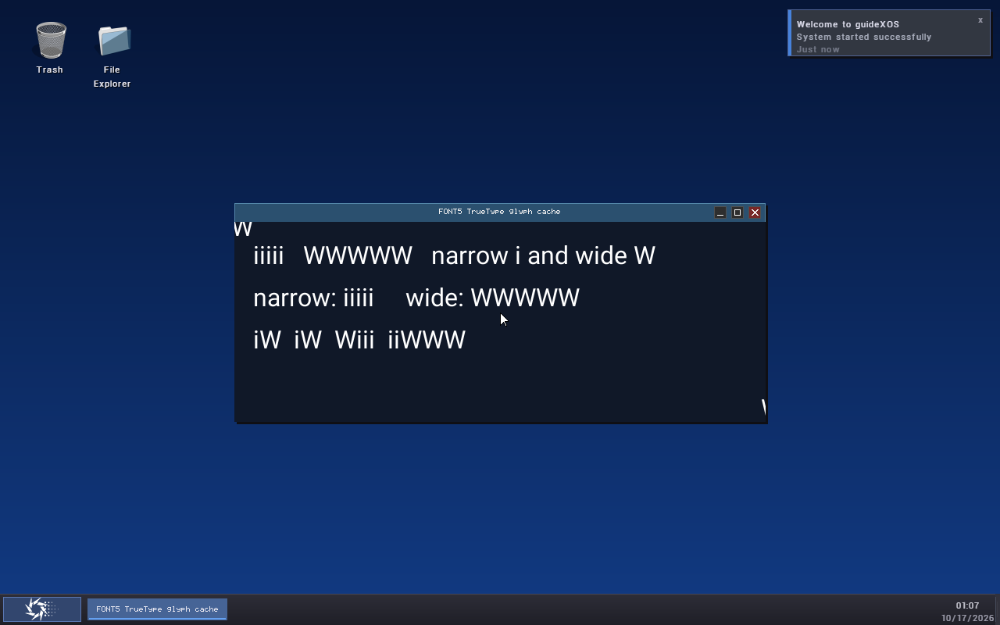

# FONT5 — Bounded Glyph Cache and Desktop Text Rendering

**Status:** Outcome A — bounded cache, grayscale draw path, production GXApp integration, regressions, full AMD64 build, and isolated QEMU desktop proof pass.

**Branch:** `FONT_SUPPORT`
**Starting HEAD:** `e1a3f4033b92de3444633617dd34b5cb12b6e4d9`

FONT5 extends the FONT2 contract, FONT3 loader, and FONT4 unhinted TrueType rasterizer with a shared coverage cache and a baseline-positioned grayscale text API. The bitmap face remains the default. Only the FONT5 sample package opts into the validated Roboto face.

## Integration point

The selected production surface is the retained `GXApp` XRGB8888 window surface in `kernel/core/native_elf_baremetal.cpp`. `NativeWindowOwner::draw_text` recognizes `com.guidexos.font5demo`, loads `resources/Roboto-Regular.ttf` through `FontTrueTypeLoadFile`, and calls `FontDrawGrayscaleTextToBuffer` on the existing surface. The sample uses the normal `gx_draw_label` and `gx_request_fixed_window` host calls; presentation still uses the existing compositor and retained-surface path.

All other native packages keep the FONT2 bitmap renderer and its existing direct bitmap fallback. Boot, framebuffer-console, serial, recovery, and system font selection paths are unchanged. FONT5 adds no persistent font preference, Settings page, shaping, or global font switch.

The guest-only proof call is guarded by `GXOS_FONT5_QEMU_PROOF`. It runs after the ordinary Navigator smoke so the package is opened after normal desktop diagnostics. During qualification, that smoke fixture was moved from the 16 KiB boot stack to one fixed-size heap-owned `NavigatorApp`; the smoke still passes and the root VFS mount remains active afterward.

## Cache design and budgets

The cache is a single fixed-size structure in `kernel/core/font_glyph_cache.cpp`. It allocates no heap memory and is called under the FONT2 manager lock. The lock order is manager then cache; cache helpers never call back into the manager. The same manager lock serializes FONT4's shared raster scratch, so there is one scratch owner at a time. These font APIs are task-context APIs, not interrupt-safe APIs.

| Resource | Bound |
|---|---:|
| Entries | 16 |
| Coverage storage | 65,536 bytes (16 × 4,096) |
| Maximum cached glyph | 4,096 pixels / bytes |
| Metadata | 4,096 bytes maximum |
| Total cache storage | 73,728 bytes maximum (72 KiB) |
| Current statically allocated cache storage | 66,896 bytes |
| Maximum raster glyph | 128 × 128 pixels, held uncached in shared scratch if it exceeds 4,096 pixels |

The key includes stable `FontId`, runtime registry slot, slot generation, glyph ID, pixel size, and raster configuration (`Gray8UnhintedV1`). The slot and generation prevent a reused registry slot from reviving old pixels; the raster configuration separates future output modes.

Eviction is deterministic LRU. The smallest unused slot is selected first; when full, the least-recently-used entry is replaced, with lower-index tie breaking. Failed rasterization is never cached. A glyph larger than one cache entry may still render from FONT4's bounded shared scratch without being retained. Cache reset clears every entry and counter. Font unload invalidates entries for its slot and generation before releasing the registered source; manager shutdown and reinitialization reset the cache.

The cache stores metrics with tightly packed grayscale coverage. Empty glyphs can be cached with zero pixels and still retain their advance. Cache statistics expose hits, misses, rasterizations, evictions, current and peak pixel bytes, entry count, and configured limits.

## Grayscale drawing behavior

`FontDrawGrayscaleTextToBuffer` takes a caller-owned 32-bit destination, byte capacity, byte row stride, dimensions, origin X, baseline Y, UTF-8 span, foreground color, and optional measurement result. It checks the full destination extent with 64-bit arithmetic before drawing, clips each glyph against all destination edges, handles off-screen glyphs, and never assumes the destination row stride equals its visible width.

Glyph placement uses `originX + xBearingPx` and `baselineY - yBearingPx`; the pen advances by each glyph's measured advance. The API supports the shared contract's CR, LF, and CRLF multiline rules. Grayscale coverage multiplies the foreground alpha, blends RGB channels against the existing destination, and writes an opaque `0xFFRRGGBB` pixel, preserving the background outside covered pixels. This matches the selected XRGB8888 GXApp surface and its opaque compositor presentation.

Missing TrueType code points use the font's replacement glyph where available. If a scalable glyph cannot rasterize, the draw uses the immutable built-in bitmap question mark for that character, keeps the original advance, and reports fallback. Existing bitmap-only callers continue through their old path.

FONT4's `RasterScratch` now contains the 16,384-byte shared grayscale coverage area; the complete scratch structure is 238,880 bytes (`0x3A520`) in kernel BSS. It remains single-owner under the manager lock and is separate from the 66,896-byte cache.

## Tests and measurements

| Command | Result |
|---|---|
| `scripts/run-font-contract-test.ps1` | PASS — 196 checks, 0 failures; includes bitmap compatibility and fallback |
| `scripts/run-font-truetype-test.ps1` | PASS — 1,150 checks, 0 failures |
| `scripts/run-font-raster-test.ps1` | PASS — 4,454 checks, 0 failures |
| `scripts/run-font-glyph-cache-test.ps1` | PASS — 228 checks, 0 failures |
| `scripts/run-settings-presentation-core-test.ps1` | PASS — 2,647/2,647 |
| `scripts/run-settings-center-model-test.ps1` | PASS — 89/89 |
| `scripts/run-native-present-validation-test.ps1` | PASS |
| `scripts/run-native-abi-layout-test.ps1` | Known unrelated baseline failure — assertion expects 248 bytes, configured MinGW reports 256 |

The hosted Roboto run measured `init_us=83`, `cold_draw_us=930`, and `warm_draw_ns_per_call=68,033`. It ended with 1,403 hits, 11 misses, 11 rasterizations, 0 evictions, 3,923 current/peak coverage bytes, and 66,896 configured cache bytes. The warm workload did not rasterize glyphs again.

The optional sanitizer build was attempted. This MinGW installation does not provide `-lasan` or `-lubsan`, so the sanitizer executable could not link; no sanitizer pass is claimed.

## AMD64 kernel validation

`mingw32-make -B ARCH=amd64` from `kernel/` compiles the production translation units with the repository's C++14 AMD64 freestanding flags and links the complete kernel. The Mbed TLS profile check passes. FONT5 production code uses no STL, exceptions, RTTI, or dynamic allocation. The separate native ABI layout assertion remains unchanged and is reported above; no unrelated SDK ABI declaration was modified.

The font cache and contract objects were checked for hosted runtime references after the full build. The current default kernel output is `kernel/build/amd64/bin/kernel.elf`; the proof-enabled image and exact run inputs are retained under `out/font5-qemu-20261016-fontsupport/`.

## Isolated QEMU desktop proof

The final run used a private OVMF copy, private ESP and media, a private COM1 log, a dynamically selected loopback QMP endpoint, 1 GiB guest RAM, and `-net none`. It did not attach to or terminate another project's guest. The demo package is discovered through the mounted root VFS and loaded through its package-relative ELF and font paths.

The serial proof reports:

- normal desktop draw and successful Navigator typography smoke;
- root `/` still mounted after that smoke;
- demo ELF open and Native ELF load pass;
- validated Roboto at 32 px on the retained GXApp surface;
- `i` advance 8 px and `W` advance 28 px;
- first draw pass: 74 hits, 11 misses, 11 rasterizations;
- repeated draw pass: 159 hits, still 11 misses and 11 rasterizations;
- clean demo exit, proof launch pass, and root `/` still mounted.

The launcher captures the screenshot before sending Escape. The screenshot shows TrueType text antialiasing, variable advances, a clipped negative-bearing `W` at the upper-left edge, and right-edge clipping, alongside the existing bitmap desktop text. The complete proof serial and sanitized launch record are in `docs/evidence/font5/`.

## Remaining limitations and FONT6 entry

Rasterization is unhinted and supports the FONT4 TrueType subset. It does not execute TrueType instructions, implement kerning, shaping, ligatures, mark placement, bidirectional text, variable fonts, or CFF outlines. The demo is package-scoped; system-wide font choice and migration of other application surfaces remain out of scope.

FONT6 should begin with a separate design for user-selected font identity and lifetime, persistence and rollback behavior, broader compositor/application adoption, and shaping/language coverage. Keep the bitmap default until those paths have their own lifecycle, fallback, memory, and guest qualification.
