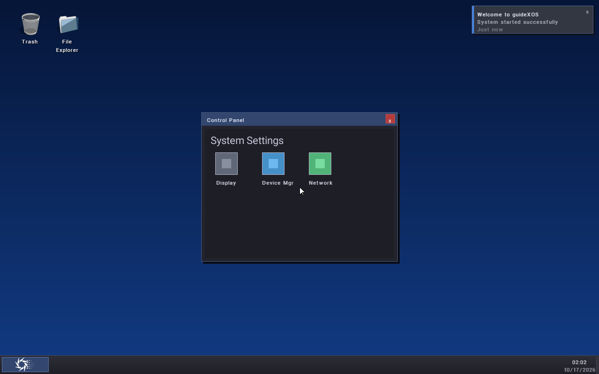
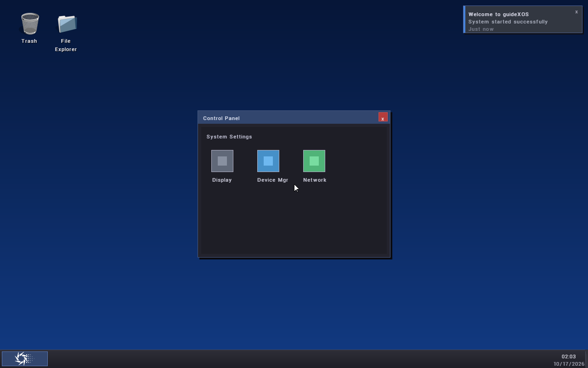

# FONT6 — System Font Selection, Persistence and Safe Rollback

**Status: Accepted.** FONT6 adds the native selection service and preference lifecycle. The Settings Fonts page remains FONT7 work.

## 1. Configuration infrastructure audit

The bare-metal Settings and desktop paths do not share a general-purpose settings database. Native desktop preferences such as wallpaper and layout use `/desktop.cfg`; individual features also keep VFS files of their own. The kernel mounts the writable system volume at `/` and starts FONT6 after that mount succeeds. This is the same VFS and filesystem path used by existing native settings and feature preferences; FONT6 does not add another storage backend.

On the tested QEMU configuration, the root volume is FAT32 on the writable ESP. `vfs::write_file` commits through the mounted filesystem and VFS rename is same-volume. The FAT implementation overwrites files in place and does not provide a general atomic replace operation. FONT6 therefore keeps two committed, fixed-size preference records and uses a scratch file plus a final rename as its commit point. The previous committed record remains available if preparation or the final rename fails. This protects against ordinary write errors and incomplete/corrupt records; FAT is not journaled, so this is not a power-loss guarantee.

Malformed, incomplete, checksum-invalid, or unsupported-version records are ignored for activation. A valid older slot wins over a corrupt newer slot. If neither slot is usable, the service keeps the built-in bitmap face active and reports `PreferenceCorrupt`, `PreferenceUnsupported`, or `NotFound` as appropriate. The service does not retry restoration in a boot loop.

The project file targets .NET 9 and invokes the kernel build before the managed build, but this checkout has no checked-in `.cs` application source beyond generated `obj` files. The current Settings presentation and native providers are C++ sources. The bounded version-1 system-service wire protocol/client/dispatcher and COM2 bridge provide the existing host boundary; they currently expose Settings network/device/storage data, not fonts. FONT6 makes no managed/native ABI change. See [FONT1's infrastructure audit](FONT1_INFRASTRUCTURE_AUDIT.md) for the wider Settings and host-boundary inventory.

## 2. Font identity

Runtime `FontHandle` values remain slot-and-generation handles and are never written to disk or returned by the selection service. A `SystemFontIdentity` value contains:

- Canonical VFS path, currently a direct child of `/system/fonts/`; the filename's case as returned by the VFS is preserved so case-only renames on case-sensitive volumes are not conflated.
- Validated family and style metadata.
- File byte length and a 64-bit content fingerprint.
- A stable identity value computed over a domain tag, canonical path, family, style, length, and content fingerprint.

The fingerprint and identity use bounded FNV hashes. They detect accidental replacement and distinguish same-family files at different paths; they are not cryptographic authentication. Candidate preparation re-reads the canonical source, validates it through FONT3, and compares its length, fingerprint, family, and style with the catalog identity. Missing files, changed files, and invalid replacements receive deterministic errors. Renaming a file changes its locator and therefore its identity. Reloading a font obtains a new runtime generation while its stable preference identity remains unchanged if the canonical source and content are unchanged.

The built-in face has its own stable bitmap identity. It is always registered independently of external-font capacity and remains selectable as the recovery/default choice.

## 3. Discovery directory and bounds

Discovery scans only direct regular-file entries under `/system/fonts/`, using the repository's lowercase VFS path convention. It accepts `.ttf` suffixes case-insensitively and exposes an entry only after `FontTrueTypeValidate` succeeds and the bounded metadata passes validation. It never recurses or downloads files.

Bounds are fixed:

| Resource | Bound |
| --- | ---: |
| Directory entries visited per scan | 64 |
| External compatible faces available | 3 |
| Font file size | FONT3's 192 KiB maximum |
| Selectable pixel size | 8–48 px |
| Preference record slots | 2 × 1 KiB, plus one 1 KiB scratch file |
| Metadata and path storage | Fixed-size arrays from the FONT2/FONT3/VFS contracts |

Directory names are sorted before validation and slot assignment. If the scan limit or three-face registry bound is reached, the result is reported without extending FONT3's registry capacity. Invalid files are not advertised as usable candidates.

## 4. Selection service

The public native service is declared in [`system_font_selection.h`](../../kernel/core/include/kernel/system_font_selection.h). It provides:

- Active and configured preference snapshots.
- A bounded list of available validated faces.
- Candidate preparation by stable identity and pixel size.
- Candidate apply, previous-selection revert, and reset to bitmap.
- Preference status and deterministic status names.

Prepared candidates contain an identity value, catalog generation, one-use token, and requested size. Apply rejects stale tokens or catalog generations. Application-facing values contain no source-byte pointers or runtime handles. The desktop-only internal bridge resolves the active handle and size for rendering; it is not an application ABI.

TrueType remains protected by FONT3's `FontCapabilityNoDefaultSelection` through the ordinary `FontManagerSetDefaultFont` API. A private manager entry point lets only the system selection implementation publish a validated TrueType face as the system default. Existing FONT3 callers retain their prior selection behavior.

## 5. Active and persisted preferences

Active state describes the face and size used by participating renderers now. Configured state describes the last durable preference and its sequence number. They are reported separately, including an `isPersisted` bit on snapshots.

The on-volume record has format version 1 and stores `sequence`, `kind`, requested `pixelSize`, hex-encoded canonical path/family/style, file length, fingerprint, stable identity, and an FNV-32 record checksum. The records are `/fontsel0.cfg` and `/fontsel1.cfg`; `/fontsel.tmp` is scratch only. No runtime handle, pointer, or glyph data is persisted.

The record format is deliberately feature-scoped because there is no shared native Settings database with transactional replacement semantics. It uses the existing root VFS and durable mounted storage. FONT7 can expose it through the managed Settings host boundary without changing the on-disk identity.

## 6. Transaction and rollback

Apply validates the stable identity and requested size, verifies the source again, and prepares metrics plus a representative glyph raster before publishing. The service then selects the manager handle and attempts the preference commit:

1. Serialize a bounded record to `/fontsel.tmp`.
2. Check the write result, file type, exact size, read-back bytes, checksum, identity, and size.
3. Remove the inactive preference slot.
4. Rename the verified scratch file into that slot. This final rename is the commit point; the current committed slot remains intact until then.
5. Publish the new active/configured snapshot, advance the selection generation, and request a desktop redraw.

If any write, validation, unlink, or rename step fails, the manager default is restored to its previous handle; active and configured snapshots remain on the previous selection. Apply returns `PersistenceFailed` (or `RollbackFailed` if the manager itself cannot restore the old valid handle) and requests a redraw so participants repaint from the service snapshot. It never reports durable success before the commit point. Hosted tests inject read, write, and rename failures and verify active/configured agreement.

Startup reads the highest-sequence valid slot, resolves the stable identity against the current validated catalog, and applies it once. Missing, corrupt, replaced, or incompatible sources leave bitmap active while retaining a valid missing TrueType preference as configured state for diagnosis/recovery. The user can select another font or explicitly reset to bitmap. A failed reset also reports failure and retains the previous active choice.

## 7. Cache invalidation and resource lifetime

FONT5 cache keys include font identity, manager slot, runtime generation, pixel size, glyph, and raster configuration. Therefore entries for a newly selected face or size cannot alias old glyphs. Switching does not clear unrelated cache entries. A size change creates misses for the new size; normal bounded LRU eviction reclaims old entries. Unloading a font invalidates only that slot/generation's entries.

The migrated desktop header has no persistent text-measurement/layout cache. It measures and draws with the service's current handle and size on each full desktop redraw. Apply/revert/reset request that redraw through the existing desktop invalidation path. The renderer writes through FONT5's clipping-aware framebuffer API; when there is no active scalable selection or a handle cannot be resolved, it uses the built-in bitmap renderer.

FONT3 copies validated source bytes into its fixed manager-owned arena at load time. The VFS source may be removed after the load without invalidating the active renderer. Manager calls serialize drawing and unload; unload waits for an in-progress FONT5 draw, invalidates that runtime generation, then allows the slot to be reused with a new generation. Resetting to bitmap does not unload the still-cataloged external faces.

The service reserves 223 KiB of static BSS: 192 KiB file staging, 16 KiB candidate glyph probe storage, 8 KiB directory names, 4 KiB preference buffers, plus about 3 KiB of records/state. The existing FONT5 cache remains bounded at 66,896 bytes including metadata. FONT3 already reserves three 192 KiB external source slots; an installed face occupies its corresponding existing slot (the QEMU Roboto file is 146,004 bytes). No heap allocation is added to kernel font selection or drawing.

## 8. Rendering consumers

FONT6 migrates one real native UI surface: the **System Settings** heading in the existing Control Panel. It uses `draw_system_text`, which opts into the active system face on the 32-bit desktop framebuffer and otherwise delegates to the bitmap renderer. The Control Panel retains its own window/dialog state, and font changes redraw it without restarting the desktop.

The Console, boot path, recovery UI, legacy desktop labels, managed apps, and other Native ELF surfaces are not migrated in this phase. FONT5's GXApp demonstration remains operational and is run in the guest proof. Application-level font overrides remain possible through explicit per-surface renderer choices; FONT6 does not force all consumers to inherit the system face.

## 9. Managed UI compatibility

This checkout has no C# Settings UI source to integrate. The existing system-service protocol is versioned and uses bounded wire records with explicit response statuses. FONT6 does not add a request type or alter that ABI. FONT7 should add an optional font query/apply request through the existing host boundary, use bounded value-owned identity/status data, and reject unsupported versions or payload sizes deterministically. It must not pass `FontHandle`, pointers, or source bytes across the boundary. Existing version-1 clients must continue to work unchanged if the font request is unavailable.

## 10. Tests and build results

FONT6 hosted coverage: **173 checks, 0 failures**. It covers discovery and traversal limits, same-family distinct paths, valid/invalid/unsupported candidates, replacement and removal, preference corruption/version rejection, save and rename failure rollback, restoration, size changes, repeated switching, stale runtime handles, generation-keyed cache misses, registry limits, redraw notifications, and bitmap fallback.

FONT2–FONT5 regression results:

| Phase | Result |
| --- | --- |
| FONT2 contract | 196/196 passed |
| FONT3 TrueType loading | 1150/1150 passed |
| FONT4 rasterization | 4454/4454 passed |
| FONT5 glyph cache/rendering | 228/228 passed |

Settings regressions also passed: presentation core 2647/2647, Settings Center 89/89, Users model/navigation/layout 32/32, Device/Storage models 45/45, Default Apps model/interaction 48/48 with 100 lifecycle cycles, Settings S6 42/42, Settings S7 58/58, and native runtime 828 checks. `validate-settings-presentation-freestanding.ps1` passed its AMD64 freestanding compile, bounded link, and unresolved-symbol checks.

Both a normal AMD64 freestanding build and a proof-enabled AMD64 build compiled and linked the full kernel. Final build logs are retained in `out/font6-build-release-final3.log` and `out/font6-build-proof-final3.log`; the proof kernel hash is recorded in the isolated guest census. The modified production objects contain no `std::`, exception, RTTI, allocator, or hosted runtime imports. Existing compiler warnings elsewhere in the repository remain non-fatal.

## 11. Guest persistence evidence

The final run used separate firmware and a private writable ESP directory, disabled networking, 1 GiB guest memory, and a fresh QEMU census before each process. The three QEMU processes were distinct; all used the same ESP path. The final census saw no foreign QEMU process. An earlier preliminary census observed an unrelated guest in another checkout; it was left untouched.

| Guest process | Result |
| --- | --- |
| First boot | Bitmap boot path remained available; validated Roboto applied live at 18 px, the Control Panel heading rendered with it, then 22 px was applied and redrawn at selection generation 3. FONT5's guest proof passed. |
| Second process, same ESP | Restored the persisted Roboto identity and 22 px preference at startup, then drew the Control Panel heading. |
| Third process, same ESP after deleting Roboto | Booted successfully with bitmap active; retained the missing TrueType preference as configured state and drew the same heading through bitmap fallback. |

The screenshots and complete serial logs are in [`docs/evidence/font6`](../evidence/font6). The actual writable ESP and full process census remain in the untracked `out/font6-qemu-20261016-fontsupport-final3/` evidence directory. This is a real QEMU process restart against the same writable storage, not an in-memory reconstruction.

## 12. Remaining limitations

- No complete Settings Fonts page, preview workflow, or install/remove UI is included; those belong to FONT7.
- Discovery currently accepts compatible `.ttf` files only, scans one directory level, and caps the catalog at three external faces.
- FNV fingerprints/checksums detect accidental changes and corruption; they do not authenticate a font against a hostile collision.
- FAT tests cover ordinary writes, restart restoration, and missing-file fallback, not sudden power loss during device-cache flushes.
- Only the Control Panel heading opts into system selection. Other desktop and application renderers need staged migration, layout review, and clipping tests.
- The native desktop path remains grayscale/unhinted TrueType with existing FONT4 shaping and glyph-coverage limits.

## 13. FONT7 entry requirements

FONT7 can now build the managed Fonts route over the stable native service. It should query available/configured/active values, show the current fallback status, preview a prepared candidate, apply/revert/reset through the service, surface deterministic persistence errors, and retain a bitmap recovery path. Keep all identities value-owned across the host boundary; do not expose runtime handles or source pointers. Add managed/native compatibility tests and migrate additional real surfaces only after text layout and clipping remain correct at multiple sizes.
