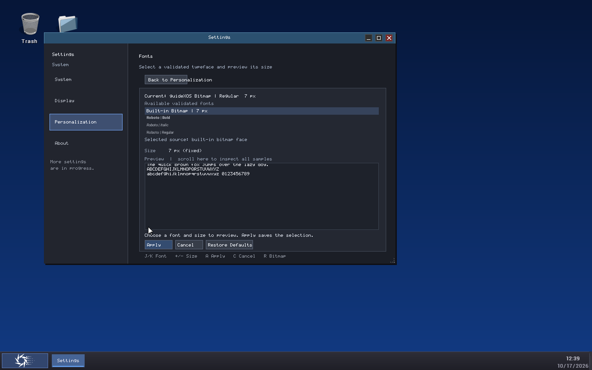
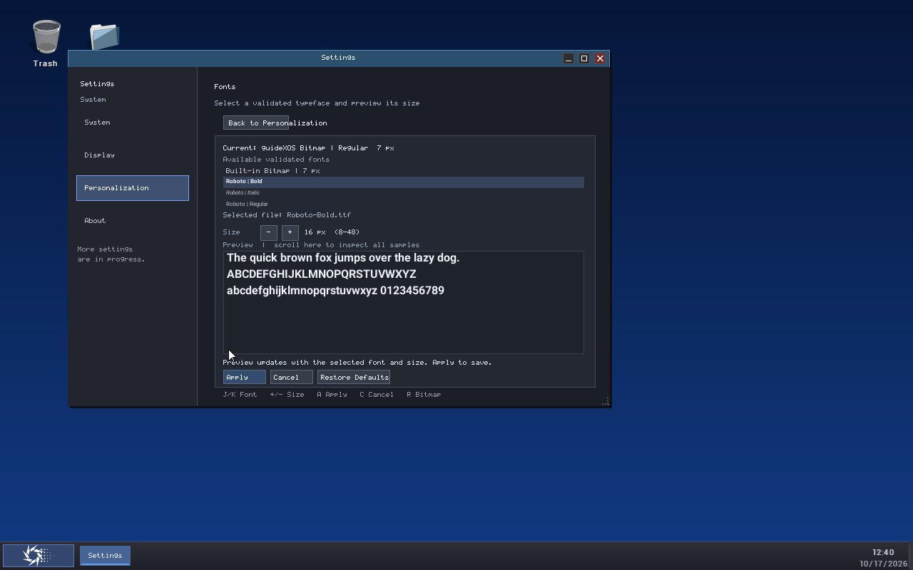
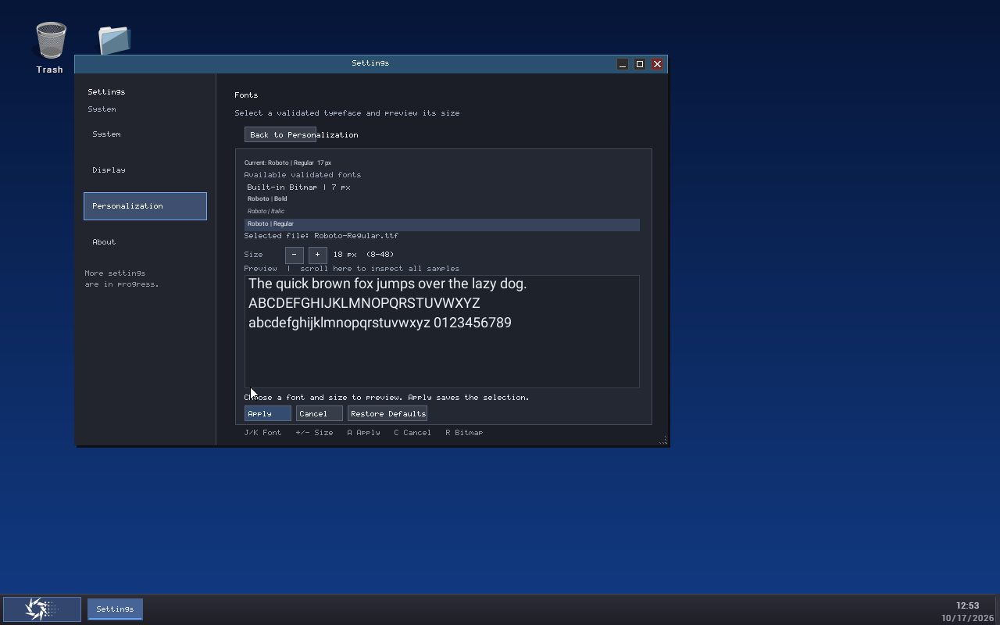
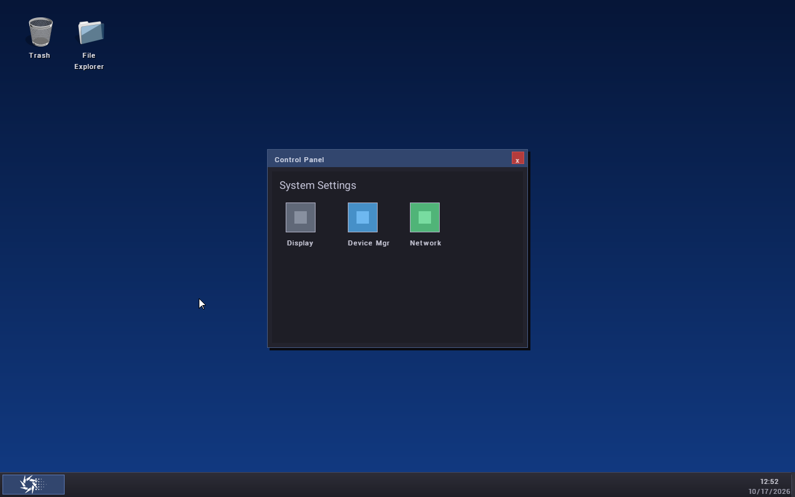
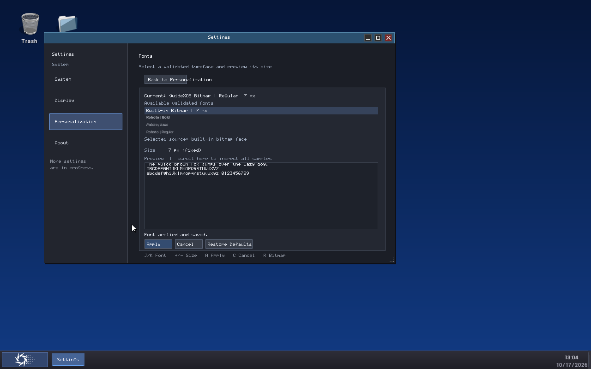

# FONT7 — Settings Font Selection and Live Preview

**Status: Implemented and guest-verified.** FONT7 exposes the FONT6 system font selection service through the existing native Settings application.

## Settings integration

The Settings entry point in this checkout is `SettingsNativeApp` in `kernel/core/kernel_apps.cpp`. It already owns the System, Display, Personalization, and About navigation and draws the actual desktop Settings window. FONT7 adds a Fonts route under Personalization (`settings://personalization/fonts`), links it from the existing Personalization page, and draws the page in that application. The Start menu still launches the existing built-in Settings app. There is no checked-in managed Settings page in this branch; the implementation uses the existing native Control Panel/desktop configuration surface and does not add a second Settings framework or alter the service ABI.

The page shows the active family, style, and size; the built-in bitmap choice; and the validated TrueType faces returned by FONT6/FONT3. The list uses FONT3's validated family/style metadata. A selected face also shows its source filename, so faces with the same family or style can be distinguished by identity/path. Invalid, unsupported, missing, and rejected faces are omitted or removed after a failed preview/refresh; they are never shown as successfully available.

TrueType size controls are bounded to 8–48 px. The bitmap renderer remains a fixed 7 px. The preview displays the requested pangram, uppercase alphabet, and lowercase/digit samples. Apply, Cancel, and Restore Defaults are visible buttons. The UI reports directory, validation, source, preview, stale-selection, persistence, and rollback errors, and identifies successful durable applies. Restore Defaults selects bitmap as a pending choice; it does not save until Apply.

Keyboard controls use the existing Settings input queue: `P` opens Personalization, `F` opens Fonts, `J`/`N` and `K`/`P` move through the font list, `1`–`4` select visible choices, `+`/`-` adjust TrueType size, `A` applies, `C` cancels, and `R`/`B` selects bitmap. The visible Back button returns to Personalization; the window's existing close button closes Settings. Pointer selection, size buttons, Apply, Cancel, Restore Defaults, and Back are handled by the native app's existing pointer events. Text uses renderer measurements and clipping; fitting labels are used for status/source text, and preview samples clip to the preview rectangle. Preview scroll input reveals all samples in shorter windows. Settings app creation/destruction owns only fixed-size page state; opening or closing the page does not retain a font handle.

## Preview and resource lifetime

The page calls the FONT6 preview entry point, which validates the supplied stable identity and size, then draws into the page's clipped framebuffer region. TrueType glyphs are looked up and rasterized through FONT3/FONT4. A separate fixed 16 KiB scratch buffer is used for preview rasterization; preview never changes the manager's system default, active selection, persisted preference, FONT5 cache contents, or selection generation. It reuses already validated registry faces and does not register another font, so it cannot consume an additional slot beyond FONT6's three-external-face limit. Rendering is serialized with selection/catalog operations. A failed preview refreshes the catalog and reports the failure while leaving the active selection intact.

Bitmap preview draws with the actual built-in bitmap font buffer renderer, clipped to the same preview bounds. It is not a look-alike simulation. The scratch buffer and preview state are bounded; the UI keeps value-owned identities and no font handles or pointers across frames.

## Apply, Cancel, Defaults, and external changes

Apply verifies that the active selection generation still matches the page's base generation. It prepares the pending TrueType candidate through FONT6 and calls the transactional apply service, or calls the explicit bitmap reset service. FONT6 validates the file again and commits the preference before publishing durable success. Success refreshes the active snapshot and lets the existing desktop redraw notification repaint the participating surface. Failure leaves or restores the prior active choice and preference; the page displays a failure status and does not claim that it was saved.

Cancel reloads the active snapshot and discards pending identity and size without writing or changing the global selection. Leaving the route or closing Settings does not apply edits; reopening Fonts seeds a fresh draft from the current active snapshot. Applying before leaving retains the applied state. Restore Defaults only changes the draft until Apply succeeds.

Font identity is value-owned and includes a stable identity over canonical path, validated family/style, file length, and content fingerprint. Candidates additionally carry a one-use token and catalog generation. The UI tracks the active selection generation. If another system component changes the active font while the page is open, the next page update discards the stale draft and displays a synchronization message. Candidate/apply stale checks prevent an old draft from overwriting the newer active font. If a source is deleted or replaced after enumeration, preview or apply revalidates it, refreshes the list, and recovers to the bitmap draft when necessary without changing the active font.

## Tests and build

FONT7 extends the Settings presentation route/search tests with direct Fonts navigation and the system selection tests with a deliberately long family label clipped to a narrow preview pane. The selection test verifies repeated TrueType previews, clipped output, preview isolation, byte-identical real bitmap rendering, missing source handling, and size boundaries. FONT6 selection tests also cover validated enumeration, empty/unavailable directories, duplicate-family files, replacement/removal after discovery, stale candidates, registry capacity, persistence failure rollback, live generation changes, and bitmap fallback. The real guest run below exercises the Fonts page, pending edits, cancellation, application, reboot restoration, and reset.

| Suite | Result |
| --- | ---: |
| FONT2 shared font contract | 196/196 |
| FONT3 TrueType loading and validation | 1150/1150 |
| FONT4 glyph rasterization | 4454/4454 |
| FONT5 glyph cache | 228/228 |
| FONT6 system font selection, including preview | 210/210 |
| Settings presentation core | 2651/2651 |
| Settings Center | 89/89 |
| Settings Users models | 32/32 |
| Settings Device/Storage models | 45/45 |
| Settings Default Apps models | 48 checks; 100 lifecycle repetitions |
| Settings S6 model | 42/42 |
| Settings S7 models | 58/58 |
| Settings native runtime | 828 checks; 100 lifecycle repetitions, 250 provider refreshes, 1000 state/notification transitions |
| Settings presentation AMD64 freestanding harness | PASS; bounded link and unresolved-symbol checks |

The corresponding scripts are `scripts/run-font-contract-test.ps1`, `run-font-truetype-test.ps1`, `run-font-raster-test.ps1`, `run-font-glyph-cache-test.ps1`, `run-system-font-selection-test.ps1`, and the `run-settings-*-test.ps1` suites. The freestanding check was run with `scripts/validate-settings-presentation-freestanding.ps1 -OutputDirectory out/font7-validation/settings-freestanding-final`.

The complete kernel is built through the repository's root target `mingw32-make amd64` (the root default target only prints help). The forced verification command was `mingw32-make -B amd64`; it rebuilds all AMD64 kernel objects and links the kernel under `-std=c++14 -ffreestanding -nostdlib -nostdinc++ -fno-exceptions -fno-rtti -fno-builtin`, with AMD64 kernel flags. The build also runs the Mbed TLS profile verification. The final log is retained at `out/font7-validation/kernel-build-forced-final.log`. Existing warnings in unrelated legacy sources are non-fatal. The modified production objects add no hosted C++ runtime, STL, exception, RTTI, allocator, or heap-runtime references; the Settings app's existing `gxos_kernel_heap_free_bytes` diagnostic is a kernel-owned API. `objdump -p` reports a zero-sized PE import directory for the completed image.

The MinGW PE-to-ELF conversion retains legacy undefined names in its symbol table (including `mainCRTStartup`, `__dso_handle`, and kernel API names that also have definitions in the image). These are not PE imports; the import directory is empty. This toolchain/output condition is recorded separately from FONT7's modified-object audit. The resulting kernel image SHA-256 is `83FA6B5D61BD32D794F785961001FFAB69F18B09FBB76F472E32354747760E29`; it matches the image hash recorded by the isolated QEMU process census and boots through the real Settings workflow below.

## Isolated QEMU acceptance

Acceptance ran in fresh QEMU processes using the private writable ESP at `out/font7-qemu-20261017-fontsupport/ESP`, a private firmware copy, disabled networking, and 1 GiB guest memory. A process-ownership census was captured before each process; each process used this task's private ESP. No other project's guest was reused, altered, or terminated. The same ESP was retained across a cold process restart. The acceptance final census reports zero QEMU processes. Screenshots, launch records, and censuses are retained in [FONT7 evidence](../evidence/font7). The complete serial logs and exact 1 KiB TrueType/bitmap preference records are in `font7-serial-and-state.zip`; the guest ESP remains in the untracked `out` evidence directory.

After that captured zero-process census, a later finalization check observed a QEMU command line using an ESP under the separate `guideXOSServer_REXX` checkout, plus another QEMU process whose command line was not available. Both were left running and were not used for FONT7 evidence.

Observed workflow in the actual desktop:

1. Opened Settings from the desktop Start menu and navigated to Personalization → Fonts. The page enumerated the validated Roboto Bold, Italic, and Regular faces and the built-in bitmap choice.
2. Rendered the sample text using pending Roboto Bold at 16 px and pending Roboto Regular at 18 px. Preview did not change the active selection.
3. Applied Roboto Regular at 17 px. The service wrote sequence 1 to `/fontsel0.cfg`; the native Control Panel's “System Settings” heading visibly changed to the selected system font.
4. Changed the pending selection and cancelled. The page reported that pending edits were discarded, while active Roboto Regular 17 px and the persisted sequence-1 preference remained unchanged.
5. Closed and reopened Settings; the saved Roboto Regular 17 px appeared. A separate QEMU process booted from the same private ESP and restored that saved selection at startup.
6. Selected Restore Defaults and applied. The page reported the bitmap font active at 7 px and sequence 2 was committed in `/fontsel1.cfg`; the desktop remained usable.
7. Added an invalid `NotAFont.ttf` fixture while the guest was stopped, then booted another isolated process. The Fonts page displayed a format error and did not list the fixture as selectable; validated Roboto entries and the desktop remained usable.

## Limitations and FONT8 handoff

- The native Settings UI can manage only the validated `.ttf` faces already in `/system/fonts/`; FONT7 does not add font installation/removal. The existing catalog scans at most 64 directory entries and the system service supports three external faces.
- The guest evidence uses a 1280×800 display; long-label clipping is covered by the narrow-pane renderer test, but a separate QEMU screenshot at the Settings window's 560×360 minimum was not captured.
- Only the existing Control Panel “System Settings” heading participates in system-font redraw in this phase. Other desktop text, boot/recovery UI, console, and application surfaces retain their existing bitmap or app-specific rendering paths.
- The root volume's FAT implementation is not journaled. FONT6's dual preference slots handle ordinary write/rename failures but do not claim a sudden power-loss guarantee during device-cache flushes.
- This branch has no checked-in managed Settings source. FONT7 integrates directly with the actual native Settings application without inventing or changing an ABI.

FONT8 can stage migration of additional real text surfaces. Each consumer needs measured layout, clipping, resize, and fallback review at supported font sizes while preserving bitmap recovery and the FONT5 cache's bounded lifetime.
